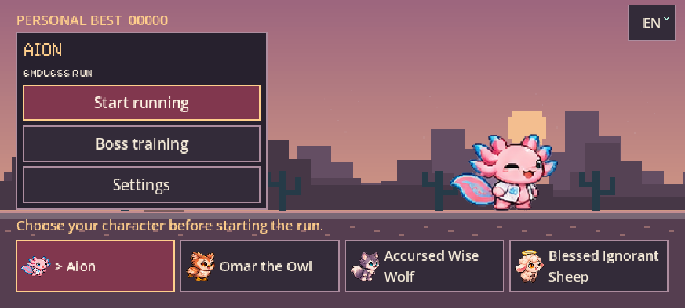

# Aion Endless Run

Sevimli, çevrimdışı bir pixel-art koşu oyunu. **Space ile zıpla, Esc ile mola ver.** Kargalara vur, engellerin altından takla at, çukurları aş ve kendi rekorunu geç. Godot **4.6.3**, oyun **0.14.0**.

**[Tarayıcıda oyna](https://aionendlessrun.vercel.app/) · [İndirilebilir sürümler](https://github.com/kaansavukduran/aion_endless_run/releases)** · [Paket ve platform durumu](docs/RELEASE.md) · [AIONIA v1.4 uygulaması](AIONIA_STANDARD.md) · [Doğrulama](docs/AIONIA-QA.md)



## Oyna

Telefon kontrolleri seçimin üzerine iki yana bölündü: solda Zıpla, sağda Vur/Takla; boss’ta Vur yerinde Ateş et. Ayarlardan eski sağ küme seçilebilir. Koyu/açık/sistem teması, sistem/pixel yazı ve büyütülmüş menü metni saklanır. Kol eylemleri yeniden atanabilir; titreşim varsayılan kapalıdır. [Kontroller](docs/CONTROLS.md).

Başlangıç kartlarından karakterini seç; koşu sırasında karakter değişmez. İlk dil cihaz/tarayıcı dilidir; desteklenmeyen diller İngilizce açılır. **TR / EN / CS** menüsünden değiştirebilirsin; seçimin ve rekorun cihazda saklanır.

| Karakter | Türkçe | English | Čeština | Yetenek |
| --- | --- | --- | --- | --- |
| Aion | Aion | Aion | Aion | Çift zıplama |
| Baykuş | Baykuş Ömer | Omar the Owl | Sova Omar | Zıpla ve basılı tut: süzül, hava akımını yakala |
| Kurt | Melun Bilge Kurt | Accursed Wise Wolf | Prokletý moudrý vlk | Shift / Depar basılı: dört ayakla hızlan |
| Koyun | Kutsanmış Cahil Koyun | Blessed Ignorant Sheep | Požehnaná nevědomá ovečka | En fazla üç can; küçük takipçiler gecikmeli zıplar |

| Eylem | Klavye / fare | Telefon | Standart Xbox / PlayStation |
| --- | --- | --- | --- |
| Zıpla / süzül | Space; baykuş için basılı | Zıpla; basılı tut | A / × |
| Tek saldırı | Sol tık / J; tekrar için bırak ve bas | Vur; her dokunuş tek saldırı | X / □ |
| Takla | Aşağı / S / Ctrl | Aşağı kaydır veya Takla | B / ○ |
| Kurt deparı | Shift; karakterin üstünü basılı tut | Depar veya kurdun üstünü basılı tut | LB / L1 |
| Boss’ta ateş | Sağ tık / F basılı | Ayrı Ateş et düğmesi | RB / R1 veya RT / R2 |
| Duraklat | Esc | Duraklat | Start / Options |

Düşerken düşmanın üstüne basarak sekebilirsin. Aion sırayla yumruk, baykuş kanat ve havada gaga, koyun kafa/çifte, kurt ısırık/pençe kullanır; depar ısırığı ayrıdır. Telefon hem dikey hem yatay oynanır; döndürmek koşuyu sıfırlamaz. İki parmakla eşzamanlı geçerli eylemler çalışır. Kısa telefon öğreticisini okurken dünya bekler; Devam et veya ilk oyun hareketinle başlar.

Dört biyom: Kehribar Çölü, Ayaz Vadisi, Sisli Bataklık ve Bakır Şehir. Gündüz/gece, hava olayları, kargalar, cüceler, seyrek ateş bitkileri, çukurlar ve kargaların taşıdığı üst engeller vardır. Her **20 saniyelik aktif normal koşu** yeni seviyedir; menü, duraklatma, sarılma ve boss zamanı bu sayaca girmez. Her on seviyede sarılma/silah teslimi ve üç tasarımı dönen boss kovalamacası vardır. Boss arenasında normal parkur temizlenir. İsteğe bağlı antrenman üç boss’u doğrudan denetir ve rekoru değiştirmez.

Kristaller +25, temiz aşılan engeller +10; mesafe de skor kazandırır. Yedi güç geçici etkiler verir. Dev mantar varsayılan %2 uygun eşya olasılığıyla nadirdir; ilk 20 saniyede ve önceki mantardan sonraki 45 saniyede gelmez. Mantar dalgasının toplam cüce üretimi yaklaşık yarıya indirildi; ortam cüceleri değişmedi. Her 100’ün katı eşiğinden sonraki ilk uygun boss zaferi **Fragaria çileğini** sunar. Bu nesne yalnız kısa kutlamadır; güç, puan veya başka oynanış ödülü vermez.

## 0.13.1 düzeltmesi

Dikey boss açıklaması ekrana sığacak biçimde sarılır; can barıyla çakışmaz. Telefonun kısa boss ipucu gerçek dokunma eylemlerini gösterir ve can bilgisi tekrarlanmaz. [Güncel doğrulama](docs/evidence-v0131/README.md).

## 0.13.0 değişiklikleri

Aion ve diğer kahramanların kare hizalaması düzeltildi. Yanlış uzak göz/gaga/solungaç seçimi yerine incelenmiş yakın göz ve gerektiğinde gövde dönüş noktası kullanılır. **Yedi kahraman PNG’si değiştirilmedi.** Doğal kuyruk/kanat/dönüş hareketleri korunur; fizik konumu kare başına kaydırılarak sorun saklanmaz.

Keskin çerçeveler, Pixelify Sans ve sıcak palet oyunun dünyasına uyar. Ana/sonuç menüsü ekrana sığar; uzun ayarlar kaydırılabilir. Sağ altta basılı/bekleme/kullanılamıyor durumlarını gösteren basamaklı yuvarlak dokunma düğmeleri vardır. Web açılışı Fragaria Interactive markasını ve gerçek indirme yüzdesini gösterir. Önceki Firefox dosya doğrulaması, bozuk önbellekten kurtarma, kayıtlar ve çevrimdışı güncelleme korunur.

## İndir

Windows: Setup ile kur veya portable ZIP’i tamamen çıkartıp EXE’yi aç. Linux: DEB, çalıştırma izni verilen AppImage veya portable tar.gz. macOS: universal DMG veya portable ZIP. Android: ARM64/x64 APK; önceki sürümle aynı uygulama kimliği ve imza, versionCode13. Gerçek paket listesi ve özetleri Releases içindedir. Önceki sürümler korunur.

İlk web yüklemesi internet ister; doğrulanmış tüm dosyalar önbelleğe alındıktan sonra çevrimdışı açılır. Mac paketi ad-hoc imzalıdır; Developer ID/noter onayı ve Windows Authenticode yoktur. Yerel iPhone/TestFlight/App Store için sahibinin Apple imzalaması gerekir; yerel portable iPhone paketi sunulmaz. Safari web sürümü ayrı bir seçenektir.

## Kaynaktan çalıştır ve derle

Godot 4.6.3 standard ile `project.godot` dosyasını içe aktar, **F5** ile başlat:

```sh
godot --editor --import --quit
godot --path .
python3 tests/test_web_packaging.py
godot --headless --script tests/test_runner_ux.gd
```

Tüm on kaynak/sahne testini `.github/workflows/build.yml` çalıştırır. Testler için gerçek oyuncu kaydından ayrı geçici XDG veri klasörleri kullan. Web: `python3 packaging/build_web.py`, çıktı `build/web`. Diğer hedefler resmi export templates ile `export_presets.cfg` içindedir. Android imza bilgileri kaynak kodda tutulmaz. Ayrıntılar: [BUILD](docs/BUILD.md), [VERCEL](docs/VERCEL.md), [VALIDATION](docs/VALIDATION.md). Tarihsel geliştirme notları [FORGE](FORGE.md) ve önceki kanıt klasörlerinde korunur.

GitHub geliştirme kaynağıdır. İstenen Drive proje kökü: [aion_endless_run](https://drive.google.com/drive/folders/1aj8Ma6N1ET_m4pNtDzPzCzYpbaaQsECf). `packaging/archive_project.py` tam commit’in özgün kaynak yollarıyla tarihli kopyasını, dosya boyutlarını ve SHA-256 envanterini üretir; Git geçmişi/issue/PR yedeği veya sürekli senkronizasyon değildir. Drive teslim işlemleri ayrı teslim raporunda doğrulanır.

## Görseller ve lisans

FireAxolotl/Extension kaynakları ve önceki paftalar korunur. Güncel kahraman tasarımları ile her PNG’nin kaynak/kare/hiza bilgileri `assets/*-PROVENANCE.json` içindedir. Yeni arayüz fontunun OFL lisansı ve Fragaria varlığının kökeni depodadır. [Kaynak ve lisans kayıtları](THIRD_PARTY_NOTICES.md). Chrome dinozorunun kodu veya görseli alınmadı. Hesap, reklam, telemetri, çevrimiçi puan tablosu veya ücretli kilit yok.

## English

An offline Godot pixel runner with four heroes, four biomes, alternating melee attacks, rolling, varied weather/enemies/powers and repeating robot boss chases. Version 0.13 repairs unwanted frame drift while preserving original hero artwork. Phones support upright portrait/landscape, down-swipe rolls, circular multitouch actions and a skippable lesson. Normal levels take 20 active seconds. Mushroom-wave gnomes are approximately halved. The rare hundred-level Fragaria celebration grants no gameplay reward. TR/EN/CS follow the device locale by default, otherwise English. Verified downloads/offline migrations preserve local records. Installers and portable editions are under Releases; evidence distinguishes real browser/model tests from unavailable physical phone/controller and Apple distribution checks.
