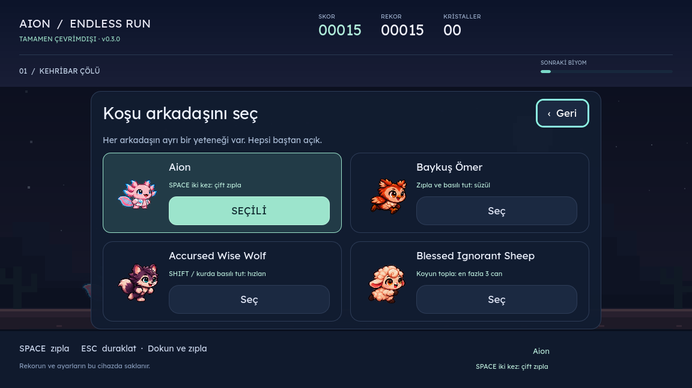

# Aion Endless Run

Sevimli bir piksel macerası. **Space ile zıpla, Esc ile mola ver.** Ateşi ve buzu aş, kristalleri topla, kendi rekorunu geç. Bağımsız Godot oyunu; Firefox veya eklenti gerektirmez. Oyun internete bağlanmaz.



**[Tarayıcıda oyna](https://aionendlessrun.vercel.app/) · [İndirilebilir sürümler](https://github.com/kaansavukduran/aion_endless_run/releases)** · [Sürüm ve platform durumu](docs/RELEASE.md) · [Doğrulama](docs/VALIDATION.md)

## Oyna

1. Releases sayfasından cihazına uygun dosyayı indir.
2. Windows: `Setup.exe` dosyasını açıp kur veya `portable.zip` dosyasını çıkartıp `AionEndlessRun.exe` dosyasına çift tıkla. Portable arşivi tümüyle çıkart; ZIP içinden çalıştırma.
3. Linux: `.AppImage` dosyasına çalıştırma izni verip aç. Debian/Ubuntu için `.deb` paketini kurabilir veya taşınabilir `.tar.gz` arşivini çıkartıp içindeki `AionEndlessRun.x86_64` dosyasını çalıştırabilirsin.
4. macOS: Intel ve Apple Silicon için universal `.app` taşınabilir ZIP veya `.dmg` vardır. İlk sürüm Developer ID ile imzalı/noter onaylı değildir; Gatekeeper açılışı engelleyebilir. Sistem korumalarını kapatmayı önermiyoruz.
5. Android: `.apk` dosyasını açarak kur. Yalnızca indirdiğin kaynağa güvendiğinde sistemin o kaynak için sunduğu yükleme iznini kullan. Paket arm64 ve x86_64 içindir; 32 bit Android desteklenmez.
6. iPhone: Bu sürümde App Store/TestFlight paketi yok. Apple Developer hesabı, dağıtım imzası ve mağaza/test onayı gerekir. Kaynak proje iOS hedefini içerir; web önizlemesi Safari'de alternatif bir oyun sürümüdür, yerel iOS kurulumu değildir.

Ana menüde **Koşuya başla** veya **Space**. Koşarken **Space**, sol tıklama veya dokunma ile zıpla. **Esc** veya sağ üst **Duraklat** düğmesiyle mola ver. Yeniden Esc ile kaldığın yerden devam et. Oyun kumandasında A zıplama, Start duraklatmadır. F11 tam ekranı değiştirir.

Baykuş, kurt ve koyunun koşu/zıplama/donma/kül animasyonları ayrı 48 karelik paftalar kullanır. Web ve indirilebilir sürümün numarası sol üstte görünür. Eski web önbelleğinden geçiş otomatik yapılır; sonraki güncellemeler oyun içindeki düğmeyle açılır.

Her atlanan engel **+10**, her toplanan kristal **+25** puan. Mesafe de skor kazandırır. Hız zamanla artar ve sınırlandırılır. Kehribar Çölü ile Ayaz Vadisi mesafeye göre yer değiştirir; gündüz ve gece bir döngü oluşturur.

Aion varsayılan karakter. **Karakterler** menüsünden Baykuş Ömer, Accursed Wise Wolf veya Blessed Ignorant Sheep seçilebilir. Hepsi ilk açılışta kullanılabilir. Aion iki kez zıplar; Baykuş Ömer tek zıplamadan sonra Space/dokunmayı basılı tutarak süzülür; koyun yerdeki arkadaşları toplayıp en fazla üç koyunluk sürü oluşturur ve her koyun bir can sağlar; kurt Shift veya karakterin üstüne basılı tutarak hızlanır. Kurtta basılı tutan parmak hızlanmayı sürdürürken ikinci parmakla başka bir yere dokunup zıplayabilirsin. Bir temasta bir koyun eksilir; son koyunda çarpışma koşuyu bitirir. Duraklatma menüsünden karakter değiştirmek açık koşuyu korur.

**Ayarlar** menüsünde Türkçe/English, bağımsız ses ve dekoratif hareket seçenekleri ile ses düzeyi bulunur. Hareket kapalıyken karakter sabit poz kullanır, parçacıklar ve arka plan kaydırması kapanır; zıplama ve engellerin hareketi oynanış için sürer. Düğmeler Tab/Shift+Tab ve Enter ile kullanılabilir. Fare, dokunma ve klavye desteklenir.

Rekor ve tercihler yereldir. Normal kayıt konumu Godot'un `app_userdata/Aion Endless Run/save.cfg` klasörüdür: Windows `%APPDATA%\Godot\app_userdata\Aion Endless Run`, Linux `~/.local/share/godot/app_userdata/Aion Endless Run`, macOS `~/Library/Application Support/Godot/app_userdata/Aion Endless Run`. Portable burada kurulum gerektirmeyen sürüm anlamındadır; kayıtlar işletim sisteminin kullanıcı veri klasöründe tutulur. Canlı koşu uygulama kapatılınca geri yüklenmez; rekor, seçili karakter ve ayarlar korunur.

## Kaynaktan çalıştır

Godot **4.6.3 standard** sürümünü kur. Bu depoyu indir ve Godot'ta `project.godot` dosyasını içe aktar. **F6 yerine F5** ile ana oyunu başlat. Komut satırı:

```sh
godot --path . --editor --import --quit
godot --path .
godot --headless --path . --script tests/test_game.gd
```

Testler kullanıcı kayıtlarına yazdığı için kendi skorunu korumak istiyorsan testleri ayrı bir OS kullanıcısı veya geçici XDG veri klasörüyle çalıştır. Linux örneği:

```sh
XDG_DATA_HOME="$(mktemp -d)" godot --headless --path . --script tests/test_game.gd
```

Resmi export templates kuruluyken `export_presets.cfg` içindeki Linux, Windows, macOS, Android, Web ve iOS hedefleri kullanılabilir. Çıktı klasörlerini önce oluştur. `.github/workflows/build.yml` her ana dal gönderiminde test ve paket üretir; sürüm etiketi gönderildiğinde doğrulanmış işler tamamlandıktan sonra beta Release yayımlar. Android imza anahtarı kaynak kodda değildir; depoya ait iki Actions secret ve `AION_ANDROID_SIGNING_READY=true` repository variable gerektirir. Ayrıntılar [paketleme notunda](docs/BUILD.md).

## Görsel kaynaklar

FireAxolotl ve FireAxolotl Extension'da kullanılan Aion koşu paftası ve arkadaş paftaları PNG içerikleri değiştirilmeden dahil edildi. Aion'un 6×8 koşu paftası kendi animasyonlarını kullanır. 0.2.0 sürümünde arkadaşların kimliklerini koruyan yeni, sağa bakan 6×6 piksel koşu/zıplama/süzülme paftası eklendi. Kollar, bacaklar ve kanatlar ayrı çizilmiş karelerle hareket eder; kaynak paftalar da korunur. Yeni paftanın kare sırası, hizalama noktaları ve kaynağı `assets/COMPANION-RUNNER-PROVENANCE.json` dosyasındadır. Donma, ateş ve kül durumları arkadaşlar için oyun içinde ortak piksel efektleriyle gösterilir.

[Kaynak ve lisans kayıtları](THIRD_PARTY_NOTICES.md). Chrome dinozorunun görseli veya kodu alınmadı. Hesap, reklam, telemetri, çevrimiçi puan tablosu veya ücretli kilit yok.

## English

A standalone offline Godot runner. **Space / tap to jump, Esc to pause.** Four available characters, fire and ice collisions, local best score, collectible crystals, two scrolling biomes and a day/night cycle. Choose **Settings → English**. Download installers and portable editions from Releases. Version 0.2.0 adds right-facing companion run frames, Aion double jump, hold-to-glide owl, collectible sheep lives (up to three) and hold-to-boost wolf. This remains a playable beta. macOS builds use development ad-hoc signing, without Developer ID/notarization; native iPhone distribution requires the owner's Apple Developer signing and App Store/TestFlight setup. See the release notes for actual platform verification, rather than assuming every produced package was device-tested.

## Vercel

[Adım adım Vercel kurulumu](docs/VERCEL.md). GitHub deposunu Vercel hesabında içe aktar, **Other** seç ve **Deploy** düğmesine bas. `vercel.json` derleme komutunu ve çıktı klasörünü belirler. MCP, API anahtarı veya veritabanı gerekmez. Vercel web oyunu içindir; kurulum paketleri Releases bölümündedir.
