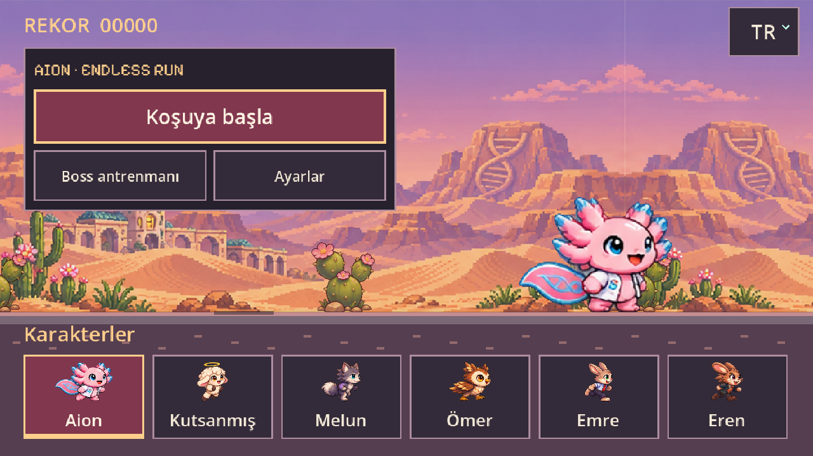

# Aion Endless Run

## 0.57.7 · Daha hızlı açılış

Oynanış değişmedi. Kare silüet verileri (sprite'ların piksel aralıkları, JSON verisinin %92'si) dışa aktarımda `addons/aion_runs_pack` eklentisiyle ikili bloklara paketleniyor; kaynak JSON dosyaları aynı kalıyor. Açılıştaki JSON yükleme süresi yerel ölçümde ~450 ms'den ~50 ms'ye, web paketi 115,1 MB'tan 110,5 MB'a indi. Kurtarma tarayıcı testinin botu artık saniyede ~8 kez tepki veriyor (önce ~2), karga dalışından kaçıyor ve atılan gnomların üstünden zıplıyor: 6/6 koşu geçti (önce 4'te 2). Ayrıntı: [Mission 1 oynanış devri](docs/MISSION1-GAMEPLAY-HANDOFF.md).

## 0.57.6 · İlk ziyarette takılmasız bölümler

Oynanış değişmedi. Her bölümün çizdiği dünya sayfaları (`assets/SECTION-SHEETS.json`, `tests/gen_section_sheets.gd` ile üretilir) bölüm kararmış geçişte yüklenirken önceden çözülür. Görev boyunca ilk kez görülen düşman/nesne sayfası yüzünden oyun içinde yapılan çözme 19'dan 2'ye indi; ortak sayfa önbelleği sınırı 8'den 12'ye çıktı (tepe 75,5 MB), çünkü kıyıda kahraman ve dünya sayfaları 8'e sığmıyordu. Ayrıntı: [Mission 1 oynanış devri](docs/MISSION1-GAMEPLAY-HANDOFF.md).

## 0.57.4 · Yarı boyutta indirme, daha az bellek

Oynanış değişmedi. Web paketi 212,4 MB'tan 115,1 MB'a indi: 136 sprite sayfası yüksek kaliteli kayıplı WebP ile saklanıyor (ortanca PSNR 41,8 dB); en çok fark edilecek 6 sayfa (seçim portreleri, panorama, iki fırlatma sayfası, kilit/tuzak, bekçi yürüyüşü) kayıpsız kaldı. Kaynak PNG'ler değişmedi. Sanat bankaları çözülmüş sayfaları artık tek, sınırlı (8 sayfa) ortak önbellekte tutuyor: aynı akışta çözülmüş sayfa belleği 107 MB'tan 69 MB'a indi. Bölüm yeniden yüklenirken (ölüm sonrası, devam, tekrar) o bölümde kullanılmış sayfalar kararmış geçişte önceden çözülür; oyun içinde çözme takılması olmaz. Ayrıntı: [Mission 1 oynanış devri](docs/MISSION1-GAMEPLAY-HANDOFF.md).

## 0.57.3 · Daha hafif oyun döngüsü

Oynanış değişmedi. Görev karesindeki üç sık işlem ölçülerek hafifletildi: mermi başına ip vuruş testi önce ucuz geometriyle eler (37,9 → 4,8 µs), kapı kontrolü düşmanları her kapı için değil karede bir kez tarar, uzak ödüller temas kontrolüne girmez. Su rotası yoğun karesinde oyun mantığı yaklaşık %30 hafifledi. Ayrıntı: [Mission 1 oynanış devri](docs/MISSION1-GAMEPLAY-HANDOFF.md).

## 0.57.2 · Doğrudan başlangıç

**Başla** ve **Oyna** seçili kahramanla görevi yeniden başlatır ve ilk karede kumandayı oyuncuya verir. **Sürdür** kayıtlı karşılaşmayı açar. Altı kahramanın kartlarında yeni yakın portreler ve göz kırpma kareleri var.

Havada ateş etmek artık zıplama animasyonunu başa almaz. Kara keşifçileri daha sık çift atış yapar ve mantar mermileri biraz daha hızlı ulaşır.

## 0.57.1 · Göreve dönüş

İlk kontrol rehberindeki **Kahraman seç** düğmesi altı portreyi açar. Son can kaybedildiğinde sol üstte 10 saniyelik kahraman seçimi görünür. Düşmanlar ve atışlar sahnede hareket etmeye devam eder. Sol ve sağ oklarla, kumandanın yön tuşlarıyla veya ekrandaki oklarla kahraman değiştirilir. **Mücadeleye dön** seçilen kahramanı aynı karşılaşmaya getirir.

Sabit topların dibinde durmak veya gövdelerinden geçmek güvenlidir. Uzaklaşınca önce namlu ışığı görünür, ardından top mermisi çıkar.

## 0.57.0 · Mission 1

Fragaria yüklemesinden sonra atlanabilir kontrol rehberi ve aynı ekrandaki altı animasyonlu portre gelir. Karakteri seçip **Başla** ile göreve girilir. Oyunun girişinde Mission 1 yer alır.

Kurbağa küçük cüce, karga, böcek ve balçıkları **E / bağlamsal yetenek** ile yutar. Aynı eylem hedefi ileri fırlatır ve çarpma çevresinde hasar verir. Yutma aralığı 10 saniyedir. Armadillo eğilip yeteneğini kullanınca daha uzun ve güçlü bir kabuk hücumu yapar.

## 0.50.0 · Altı kahramanlı Mission 1 adayı

Aion, Kutsanmış, Ayça ve Eren korunur; Armadillo eğilerek kabuğuna kapanıp hücum eder, Kurbağa ağzına bağlı diliyle mesafeli saldırır. Yeni yetenekler **E / Y / bağlamsal dokunma düğmesi** ile kullanılır; yakındaki araç ve bilinçli silah değişimi önceliklidir. Armadillo için önce eğil. Ömer ve Melun yardımcı güçler olarak kalır. Bu tarihsel sürümde klasik Sonsuz modu özgün dört kahramanla ayrıydı.

Gerçek geri yürüme klipleri, tek bırakma anıyla el bombası, ardışık saldırı/toparlanma, altılı seçim ve yeni fener korusu açılışı entegre edilmiştir. 0.50 GitHub Pages'te yayımlandı; kullanıcı görsel/oynanış kabulü bekliyor. Kaynak, test ve yayın durumları [tek Mission 1 devir kaydında](docs/MISSION1-GAMEPLAY-HANDOFF.md) ayrı tutulur. **Mission 2 geliştirilmez.**

[GitHub Pages oyun adresi](https://kaansavukduran.github.io/aion_endless_run/)

## 0.30.0 · Doğal yol ayrımları

Mission 1'in iki yol ayrımı artık farklı fiziksel fikirlerle seçiliyor. Kıyıda alt su yoluna iskele binasının altındaki alçak bakım geçidinden eğilip sürünerek girilir; tavan gerçek çarpışmadır. Kanopide kökle kilitli kapağın mekanizması kırılınca kök geçidi açılır; üst hizmet yolunun orta açıklığı basıldıktan sonra çöker. Ayrıntı: [Mission 1 oynanış devri](docs/MISSION1-GAMEPLAY-HANDOFF.md).

## 0.29.0 · Serbest nişan ve hızlı açılış

Görev modunda silah bilgisayarda fare imlecini takip eder; mobil joystick ve gamepad 8 yöne yuvarlanmadan gerçek açıya nişan alır, klavye 8 yönü korur. Web açılışı ve oyun içi akıcılık optimize edildi: sprite kareleri GPU geri okuması olmadan çözülür, oyuncu sürümünde kare başına test verisi yazılmaz, motor PCK ile paralel iner, sekme gizlenince koşu duraklar. Kullanılmayan dosyalar paketten çıkarıldı (PCK 174,6 → 168,5 MB).

## 0.28.0 · Mission 1 ritmi ve toparlanma

Üst/alt atış rolleri ve sınırları belirli karşılaşma varyantları, bilinçli silah seçimi, ara kontrol noktaları, çöken köprü, zincir puanı ve üç evreli Kök Motoru davranışı. Aynı silahın cephanesi eklenir; farklı özel silah yerde kalır: **E / Y / Değiştir** ile seçilir. Araçla temas ederek ikmal alma korunur. Kontrol noktaları konumu ve ikmali saklar; tekrar denemede kazanılmış puan/eşyalar ikinci kez verilmez. [Kapsam ve gerçek doğrulama](docs/evidence-rhythm/README.md).

## 0.27.1 · Ahşap platformlar ve ikmal kutuları

Kutu ve çıkılabilir platformlar, yerel olarak çizilmiş perçinli ahşap pixel-art parçaları kullanır. Kapak/çerçeve, ahşap damarları, metal köşeler, çift yönlü payanda ve yere oturan ayaklar vardır. Uzun kirişler dokuyu esnetmeden döşenir. Rota, platform çarpışmaları, kutu içeriği ve kayıtlar korunur. [Görsel ve doğrulama kaydı](docs/evidence-timber/README.md).

## 0.27.0 · Araçla ikmal, akıcı nişan ve ölüm animasyonları

Araçla NPC teması ve gerçek eşya toplama, sekiz hedef yönü arasında ara açılara ateş, Shift depar/sağ tık bomba, yeni dalgalanan bayrak ve türe özel opak ölüm kareleri. [Değişiklikler ve gerçek doğrulama](docs/evidence-0270/README.md).

Korsan bekçinin iki kolu görülen altı yeni yürüyüş karesi, araçlarda gerçek zıplama ve üçlü yayılım, ipleri patlamasıyla çözen örümcek ve daha hızlı/uzun menzilli özel mermiler. [Test ve görsel kanıt](docs/evidence-combat-0262/README.md).

**Arcade / Sönen Fenerler**: Aion, iki ayaklı Kutsanmış, Ayça, Eren, Armadillo ve Kurbağa ile Mission 1. İki yol ayrımında üst köprülere zıpla veya alt kanaldan ilerle; oyun rotayı fiziksel konumundan seçer. Yol seçme metin menüsü yoktur. Bölüm geçişleri otomatik kısa solmayla gerçekleşir.

Ömer ve Melun artık oynanabilir karakter değil, toplanan yardımcı güçlerdir: tüy iki alan etkili taş saldırısı, kurt simgesi iki ayrı hedefe koşup ısırma sağlar. Aynı beş hareket/ateş eylemi için ortak gövde, el ve zemin kaydı kullanılır. Ateş etmek koşu karelerini durdurmaz. Ayça, eski Emre yuvasında kendine ait etekli/tokalı çizimini kullanır; Eren ayrı kalır. Eski kaynak paftaları değiştirilmez.

**Arcade kontrolleri:** A/D veya oklarla yürü; S/Aşağı basılı tutarak eğil ve ilerle; Space zıpla; F/sol tık ateş et; sağ tık/G bomba; Shift depar; E bin/in veya silah değiştir. Aşağı+Zıpla ile tek yönlü platformdan in. Telefonda solda sabit joystick, sağda Zıpla/Ateş/Bomba; joystick'i aşağı çekerek eğil. Kolda sol çubuk/yön tuşları, A/× zıpla, RB/R1 veya X/□ ateş, B/○ bomba, Y/△ bin/in, Start/Options duraklat; kayıtlı eşlemeler korunur. Araçta sağ çubuk veya fareyle kesintisiz nişan al. Araçlar üç can taşır.

Yürüyen örümcek mayınları hedefe gider; beş saniye içinde patlar. Kurtarılan fener bekçileri çantadan fiziksel ikmal bırakır; eşyaya temas edince alınır. Menü ve oyun yalnız **Türkçe/English** sunar. Dikey/yatay telefon, klavye/fare ve gamepad desteği korunur. Eski sonsuz mod önceki sürümlere aittir.

[Oyunu oyna](https://kaansavukduran.github.io/aion_endless_run/) · [Teslim ve gerçek testler](docs/M1-DELIVERY.md) · [Fiziksel rotalar](docs/M1-FLOW-VALIDATION.md) · [Karakter paftaları](docs/M1-HERO-ART.md) · [Yerel Unslop kuralları ve QA](docs/M1-SKILL-QA-INVENTORY.md)

Bu sürüm Mission 1'i geliştirir; Mission 2–5'in tamamlandığı iddia edilmez. Önceki yayımlanmış indirme paketleri yeni web sürümünden ayrıdır. Aşağıdaki bölüm önceki teslimlerin tarihsel kaydıdır; eski karakter/dil listeleri güncel kadroyu tarif etmez.

0.26.1, yeni hareket katmanının sonsuz moddaki mevcut tepki/sarılma pozlarını ve kırmızı silah teslimini örtmesini düzeltir. Dört karakterin gerçek ana sahne seçicisi 728 kontrolle sınanır; Arcade rotaları ve kayıt biçimi değişmez. [Ara sahne regresyon kanıtı](docs/evidence-cinematic-priority/README.md).

# Önceki sürümlerin kayıtları


## 0.25.0 · Fener Ormanı arcade sunumu

Atlanabilir AIONIA açılışı, kayıt yazmayan gerçek Attract Mode, altı animasyonlu kahraman kartı, görsel yardım, kompakt görev HUD'ı ve ayrıntılı gerçek görev raporu. Ömer havada, Melun koşarken silahını ağzında taşır; iki tavşan kısa basışta Aion'un 1,75 katına, tam şarjda yaklaşık 4 katına sıçrar. Ömer'in üç hava kanat hakkı vardır. NPC'lerin bağı bıçak veya mermiyle çözülür; dolaşan NPC ile temas teşekkür ve tek seferlik ödülü başlatır. Araçlara girme/çıkma animasyonu ve namluyla eşleşen sekiz yönlü atış korunur.

[Kapsam ve doğrulama](docs/AIONIA-FORGE-20261115.md) · [Yeni kahraman çizimleri](docs/FORGE-HERO-ART.md) · [Araç gövde/namlu kaydı](docs/FORGE-VEHICLE-ART.md) · [Web oyun adresi](https://aionendlessrun.vercel.app/). Yeni çizimler oyun içi üretimdir; resmî kanon/logo onayı iddiası değildir. Eski kaynaklar ve indirmeler korunur.

**0.24.0 · Mission 1 kurtarma ve içerik genişlemesi:** Altı kahramanın bıçakla bağ kesmesi, gerçek NPC hediyeleri ve yeni rota içeriği için [tasarım ve kapsam](docs/CAMPAIGN-EXPANSION.md), [test kanıtları](docs/evidence-campaign-expansion/README.md). [Vercel'de oyna](https://aionendlessrun.vercel.app/). Aşağıdaki sürüm kayıtları önceki teslimlerin kapsamını anlatır.

## 0.23.0 · İlk arcade görev: Sönen Fenerler

[Vercel'de oyna](https://aionendlessrun.vercel.app/) · [GitHub Pages'te oyna](https://kaansavukduran.github.io/aion_endless_run/) · [Gerçek testler ve yayın kaydı](docs/evidence-arcade-m1/README.md)

Ana menüde **Arcade** yeni sonlu görevi, **Sonsuz / Endless** önceki koşu oyununu açar. Altı mevcut kahraman korunur. Yeni modda karakter sağa ve sola yürür; iki ardışık yol ayrımı üç farklı son rotaya açılır. Fener bekçilerini kurtar, ikmal sandıklarını aç, Fener Kızağı’na bin ve Kök Motoru’nu durdur. Yakındaki düşmanda ateş düğmesi karaktere uygun tek bir temas saldırısına dönüşür. Bombalar kahramanın rengini taşır; doldurma yoktur.

**Telefon:** solda sabit joystick; sağda Zıpla, Ateş/Yakın saldırı ve Bomba. **Klavye:** A/D veya oklar, Space, F/sol tık, G bomba, E bin/in. **Kol:** sol çubuk/yön tuşları, A/× zıpla, RB/R1 veya X/□ ateş, B/○ bomba, Y/△ bin/in; kayıtlı eşlemeler dikkate alınır. [Yeni modun kuralları ve kontrolleri](docs/ARCADE.md).

Bu, beş görevlik dönüşümün ilk oynanabilir bölümüdür; Görev 2–5 henüz oynanabilir değildir. [Metal Slug 3 araştırması ve beş görevlik özgün plan](docs/ARCADE-PLAN.md). Mevcut sonsuz koşu, rekorları ve ayarları ayrı kalır. Kampanya kontrol noktası kendi kaydını kullanır. Daha önce yayımlanan 0.22.0 indirme paketleri değiştirilmez; yeni web ve yeni paketlerin durumunu teslim raporundan ayırarak kontrol et.

**Önceki sonsuz mod ve 0.22.0 indirmeleri:** Sevimli, çevrimdışı bir pixel-art koşu oyunu. **Space ile zıpla, Esc ile mola ver.** İleri ateş et, engellerin altından takla at, çukurları aş ve kendi rekorunu geç. Motor Godot **4.6.3**; yukarıdaki yeni arcade web sürümü **0.23.0**.

**[Güncel oyunu oyna](https://kaansavukduran.github.io/aion_endless_run/) · [0.22.0 indir](https://github.com/kaansavukduran/aion_endless_run/releases/tag/v0.22.0)** · [Vercel adresi](https://aionendlessrun.vercel.app/) · [Paket ve platform durumu](docs/RELEASE.md) · [AIONIA uygulama notları](AIONIA_STANDARD.md) · [Doğrulama](docs/evidence-v0220/README.md)



0.21.0: Boss’lar5 seviyede bir gelir. Üç boss için farklı konuşmalar, altı kahramanın şaşırma çizimleri ve kırmızı tabanca teslimi eklendi. Ara sahnede koşu donar; Devam/Atla klavye, dokunma ve kolla çalışır. Kırmızı tabanca koşu boyunca boss’a iki kat hasar verir. Yerdeki altı kahramanın ayak hizası düzeltildi; basılı takla döngülüdür ve skor bandı inceltildi. Sınırsız0,32s ateş,15s seviyeler,11 dil, yetenekler ve kayıtlar korunur. [Bu sürümün kanıtı](docs/evidence-v0210/README.md).

## Web zemini güncellemesi

Altı biyoma uygun pixel-art yol: kumtaşı, kar/buz kenarı, yosunlu toprak, aşınmış şehir taşları, orman kökleri ve bazalt. Düz renk/çizgi dolgusu yerine katmanlı malzeme, gömülü taşlar ve sakin bir alt doku kullanılır. Karakterlerin bastığı zemin ve çarpışma kuralları değişmez. [Gerçek ekranlar ve doğrulama](docs/evidence-terrain/README.md). Bu web güncellemesi önceki0.22.0 indirme paketlerinin üzerine yazmaz.

## 0.22.0 · Paftaya sadık görsel yenileme

Aion'un pembe derisi, mavi uçlu pembe solungaçları, bilim önlüğü ve DNA kuyruğu korunur. Kutsanmış artık özgün modelindeki gibi **iki ayaklı** koşar; küçük takipçiler aynı kaynağı kullanır. Yeni karga/cüce, sekiz meyve ve on güç simgesi ortak pixel-art malzeme/ışık dili kullanır.56 eski PNG değişmez; altı yeni pafta eklenir.

**Ömer:** zıpla ve basılı tutarak süzül; havada bırakıp yeniden basarak üç kez kanat çırp. İlk sıçrama hakkı tüketmez; yere inince üç hak yenilenir. **Emre ve Eren:** Zıpla'yı tutarak güç biriktir, bırakınca sıçra;1,2 saniyede tam güç. Eren kendi ayrı çizimini ve kimliğini korur.

Yükleyicide dolan tüm segmentler, yüzde ve hazırlık noktaları çilek kırmızısıdır; gerçek ilerleme ölçülemiyorsa yüzde uydurulmaz. Opak ayak/kök hizaları ve Aion'un gerçek çizilmiş yüzü denetlenir. Sınırsız0,32s tabanca,15 aktif saniyelik seviyeler,5 seviyede bir boss ve mevcut ara sahneler, kayıtlar,11 dil ve bölünmüş dokunma düzeni korunur.

[Gerçek ekranlar, testler ve platform sınırları](docs/evidence-v0220/README.md). Fiziksel Poco/iPhone veya fiziksel kol denendiği iddia edilmez. Sonraki bölümler önceki sürümlerin tarihsel geliştirme notlarını içerir.

## Oyna

Telefon kontrolleri seçimin üzerine iki yana bölündü: solda Zıpla, sağda Ateş et/Takla. Tabanca her zaman elde; sınırsız mermi, 0,32 saniyelik ortak atış aralığı. Doldurma yoktur. Dikey ekranda kısa canlı yetenek durumları okunaklı kalır. Ayarlardan eski sağ küme seçilebilir. Koyu/açık/sistem teması, sistem/pixel yazı ve büyütülmüş menü metni saklanır. Kol eylemleri yeniden atanabilir; titreşim varsayılan kapalıdır. [Kontroller](docs/CONTROLS.md).

Başlangıç kartlarından karakterini seç; koşu sırasında karakter değişmez. İlk dil cihaz/tarayıcı dilidir; desteklenmeyen diller İngilizce açılır. **TR / EN / CS / AZ / DE / FR / JA / KO / ZH / ES / IT** menüsünden değiştirebilirsin; seçimin ve rekorun cihazda saklanır.

| Karakter adı (bütün dillerde) | Yetenek |
| --- | --- |
| Aion | Çift zıplama |
| Kutsanmış | En fazla üç can; küçük takipçiler gecikmeli zıplar |
| Melun | Shift / Depar basılı: dört ayakla hızlan |
| Ömer | Zıpla ve basılı tut: süzül, hava akımını yakala |
| Emre | Zıplamayı basılı tut: şarj et; bırak: sıçra |
| Eren | Tut: şarj et; bırak: sıçra; kendine ait ayrı karakter paftası |

| Eylem | Klavye / fare | Telefon | Standart Xbox / PlayStation |
| --- | --- | --- | --- |
| İleri ateş | Sol veya sağ tık / F basılı | Ateş et basılı | RB / R1 veya RT / R2 |
| Ek ateş girişi | R / J basılı | Aynı Ateş et düğmesi | X / □ basılı |
| Zıpla / süzül | Space; Ömer için tut/yeniden bas, Emre/Eren için tutup bırak | Zıpla; Emre/Eren için tutup bırak | A / ×; Emre/Eren için tutup bırak |
| Takla | Aşağı / S / Ctrl | Aşağı kaydır veya Takla | B / ○ |
| Melun deparı | Shift; karakterin üstünü basılı tut | Depar veya karakterin üstünü basılı tut | LB / L1 |
| Duraklat | Esc | Duraklat | Start / Options |

Yumruk eylemi kaldırıldı. Her kahraman düz ileri tabanca sıkar; mermi bittiği için durmaz; doldurma eylemi yoktur. Toplanan şimşek, normal koşudaki tabanca atışına ek alan etkisi verir. Düşerken düşmanın üstüne basarak sekebilirsin. Telefon hem dikey hem yatay oynanır; döndürmek koşuyu sıfırlamaz. İki parmakla eşzamanlı geçerli eylemler çalışır. Kısa telefon öğreticisini okurken dünya bekler.

Altı biyom: Kehribar Çölü, Ayaz Vadisi, Sisli Bataklık, Bakır Şehir, Fener Ormanı ve Kor Sırtı. Gündüz/gece, hava olayları, kargalar, cüceler, seyrek ateş bitkileri, çukurlar ve kargaların taşıdığı üst engeller vardır. Her **15 saniyelik aktif normal koşu** yeni seviyedir; menü, duraklatma, sarılma ve boss zamanı bu sayaca girmez. Her on seviyede sarılma ve ve üç tasarımı dönen boss kovalamacası vardır. Boss arenasında normal parkur temizlenir. İsteğe bağlı antrenman üç boss’u doğrudan denetir ve rekoru değiştirmez.

Meyveler +25, temiz aşılan engeller +10; mesafe de skor kazandırır. On toplanabilir güç bulunur. Sıçrama tılsımı 9 saniye daha yüksek zıplatır, şans parası 12 saniye meyve puanını ikiye katlar, buz feneri 8 saniye yakındaki yaklaşan düşmanları yavaşlatır. Dev mantar varsayılan %2 uygun eşya olasılığıyla nadirdir; ilk 20 saniyede ve önceki mantardan sonraki 45 saniyede gelmez. Mantar dalgasının toplam cüce üretimi yaklaşık yarıya indirildi; ortam cüceleri değişmedi. Her 100’ün katı eşiğinden sonraki ilk uygun boss zaferi **Fragaria çileğini** sunar. Bu nesne yalnız kısa kutlamadır; güç, puan veya başka oynanış ödülü vermez.

## 0.21.0 · Beş seviyede bir hikâyeli boss

Normal koşuda5/10/15… seviyelerde üç boss sırayla döner.10 seviyelik sarılmalar korunur. Boss konuşur, kahraman şaşırır, yardımcısı kırmızı tabancayı uzatır. Okuma süresi sınırlı değildir; **Devam** veya **Atla** ile ilerlenir. Antrenman hızlı girişini korur. Kırmızı tabancanın gerçek mermileri boss’a2 hasar verir; yeni koşuda normal tabanca geri gelir. Taklayı basılı tutmak düşük omuz taklası karelerini tekrarlar; topa dönüşme veya fizik konumunu oynatma yoktur.

## 0.20.0 · Yeni kahraman pixel-art paftaları

Aion, Ömer, Melun, Kutsanmış, Emre ve Eren için6 yeni pafta,396 farklı çizilmiş poz. Daha belirgin malzeme gölgeleri, piksel kümeleri ve seçici konturlar; özgün renkler ve karakter kimlikleri korunur. Koşu/ateş/uçuş yüz kaydı, tam kulak/ayak kesimi, alçak tek omuz taklası ve dar silah eki aynı mevcut oyun akışına bağlıdır. Özgün PNG'ler saklanır.

[Sanat sözleşmesi](docs/ART_BIBLE.md) · [Doğrulama](docs/evidence-v0200/README.md). Kontroller ve kayıt sistemi korunur; şarjör/reload geri eklenmez.

## 0.19.0 · Sabit yüz hizası, omuz taklası, Eren

Yanlış mavi renk işaretçisi Aion ve Melun'un bazı ateş karelerinde yüz yerine başka ayrıntıyı seçiyordu. Bütün yüzün burun/yanak/çevre piksellerini karşılaştıran kayıt, aynı fizik noktası ve karakter ölçeğinde gerçek yüzü sabitler. Kaynak piksel fazı da tüm döngüde aynıdır. Hareketli kanat ve kuyruklar dondurulmaz; eski PNG'ler değiştirilmez.

Beş kahraman için60 gerçek omuz taklası pozu; Eren için79 ayrı çizilmiş hareket/ateş/takla/hasar pozu. Taklada diz bükme, ellerin yere inmesi, omuz üzerinden öne dönüş ve doğrulma okunur. Basılı takla sürekli top gibi dönmez, eğilerek bekler. Emre'nin şarjı, Ömer'in süzülmesi, Melun'un dört ayak deparı, Aion'un çift sıçraması ve gecikmeli koyun takipçileri korunur.

Aşağıdaki sürüm bölümleri tarihçedir; eski şarjör/doldurma ve dönen top taklası güncel oyunda yoktur.

## 0.18.0 · Alçak takla ve şarjlı Emre sıçraması

Beş kahramana12'şer yeni çizilmiş poz: diz bükme, yere yaklaşma, saat yönünde öne takla ve doğrulma. Sabit fizik noktası/tek ölçek kullanılır; karakter çizimi ezilip dikey olarak sıkıştırılmaz. Basılı taklada giriş pozu tekrar etmez, karakter alçakta dönmeye devam eder. Koyun takipçileri kendi gecikmeli yol kayıtlarına göre aynı hareketi yapar.

Emre zıplama basılıyken yerde güç biriktirir, bırakınca sıçrar.1,2 saniyede tam güce ulaşır; kısa basış alçak, uzun basış yüksek tek sıçrama verir. Klavye, dokunma ve gamepad aynı eylemi kullanır. Havada ikinci şarj yoktur. Dokunma iptali/odak kaybı/yön değişimi birikmiş gücü yanlışlıkla sıçratmaz. Şarj oranı küçük piksel işaretleriyle görünür; uzun seviye barı geri eklenmedi.

Ana menü, sonuç, duraklatma, karakterler, diller, ilk yardım ve uzun ayarlar fare tekerleği istemez. Uzun içerikte Önceki/Sonraki okları kullanılır; sonuçta Yeniden koş ve Ana menü erişilebilir kalır. %200 yazı ve mevcut tema/font tercihi korunur. Sayısal ayarın adı ile kaydırıcısı aynı gruptadır. Seçilen iki yana bölünmüş mobil düzen ve5 mermili tabanca korunur.

## 0.17.0 · Her zaman tabanca, kompakt menü

Beş mermi, elle bir saniyelik doldurma; normal koşuda ve boss'ta aynı silah. Özgün karakter çizimleri korunur. Ömer süzülürken ve Melun dört ayaklı depar yaparken tabanca ayrı, kendi paftasından alınmış parça olarak çizilir; hareket animasyonu değişmez.

Ana menü %200 yazıda da beş kısa isimli kart ve üç işlemi kaydırmadan gösterir. Eski dil tercihleri bir kez cihaz/tarayıcı diline döner; yeni açık seçimler saklanır. Dil menüsünde **Sistem dili** seçeneği bulunur. Tema, yazı büyüklüğü ve rekorlar sıfırlanmaz. Uzun seviye/XP barları kaldırıldı; seviyeler 15 aktif saniyedir. Kaktüs, çam/fener, söğüt, şehir saksısı, orman ve kor bitkileri üçer çizilmiş pozla hafifçe salınır; hareket kapalıysa sabittir.

## 0.16.0 · Aionverse manzaraları, meyveler ve Emre

Altı biyom artık piksel resimli Aionverse manzaraları kullanır: gözlemevleri, botanik laboratuvarları, bakır çatılar, karlı dağlar, bataklık seraları ve fenerli ormanlar. Hareket, gece/gündüz, hava ve boss geçişleri korunur.

Sıradan kristaller yerine **muz, elma, armut, kayısı, kara üzüm, portakal, kiraz ve şeftali** toplanır; her biri +25 puandır. Daha sık 3–5'li meyve dizileri, zeminden toplanabilen yükseklikte ve tehlikelerden uzakta çıkar. Uçan engelin üstüne kristal koyan karşılaşma kuralı kaldırıldı; sonradan gelen tehlikelerle yerleşim yeniden denetlenir. Güç mıknatısı ve şans bonusu meyvelerle çalışır; nadir Fragaria çileği ayrı kutlama olarak kalır.

**Tavşan Emre** beşinci oynanabilir kahramandır. Sahibinin resmi paftasındaki açık kahverengi kürk, yeşil göz, mavi gömlek ve kırmızı kravat korunur. 144 çizilmiş poz; tek güçlü sıçrama, dönüşümlü yumruk/tekme, takla, boss tabancası, donma/yanma ve düşüş. Diğer 41 PNG değişmedi. [Gerçek ekranlar ve test kapsamı](docs/evidence-v0160/README.md).

## 0.15.1 görsel iyileştirmesi

Yarasa, balçık, kabuk böceği ve fırtına ışığı için 24 ayrıntılı animasyon karesi eklendi. Telefon tuşları simetrik basamaklı çerçeveler, elle çizilmiş piksel ikonlar ve belirgin basılı/bekleme durumları kullanır. İki yana bölünmüş kontroller, dokunma alanları ve özgün kahraman çizimleri korunur. [Çalışan oyun görüntüleri ve doğrulama](docs/evidence-v0151/README.md).

## 0.15.0

Normal düşmanlar tek vuruşta veya üstüne basınca yenilir; yenmek 10 XP, üstüne basmak 15 XP, boss yenmek 100 XP verir. Her 100 XP koşu ustalık derecesini artırır; süreye bağlı seviyeler yine 20 saniyedir. Şimşek yakın saldırıda harcanmaz: sağ tık/F/RB/Şimşek ile 1500 birimlik geniş bir hat boyunca vurur. Yarasa, balçık, kabuk böceği ve fırtına ışığı eklendi. Boss sonrası arka plan/koşu sıçraması giderildi; hız, silah ve gösterge yumuşak geçer. [Ayrıntılar](docs/UPGRADE-0.15.0.md).

## 0.14.1 düzeltmesi

Android sistem yazı tipiyle 9:16 ekranda Ayarlar ve karakter başlığının çakışması giderildi. Telefon menüsü iki yönde kompakt bir başlık ve karakter seçimine kadar gerçek ayrılmış yükseklik kullanır. 1440×2560 kaynak ve 450×800 tarayıcı regresyonu ile gerçek Android UI sınırı kontrolü eklendi. [0.14.1 kanıtları](docs/evidence-v0141/README.md).

## 0.13.1 düzeltmesi

Dikey boss açıklaması ekrana sığacak biçimde sarılır; can barıyla çakışmaz. Telefonun kısa boss ipucu gerçek dokunma eylemlerini gösterir ve can bilgisi tekrarlanmaz. [Güncel doğrulama](docs/evidence-v0131/README.md).

## 0.13.0 değişiklikleri

Aion ve diğer kahramanların kare hizalaması düzeltildi. Yanlış uzak göz/gaga/solungaç seçimi yerine incelenmiş yakın göz ve gerektiğinde gövde dönüş noktası kullanılır. **Yedi kahraman PNG’si değiştirilmedi.** Doğal kuyruk/kanat/dönüş hareketleri korunur; fizik konumu kare başına kaydırılarak sorun saklanmaz.

Keskin çerçeveler, Pixelify Sans ve sıcak palet oyunun dünyasına uyar. Ana/sonuç menüsü ekrana sığar; uzun ayarlar kaydırılabilir. Sağ altta basılı/bekleme/kullanılamıyor durumlarını gösteren basamaklı yuvarlak dokunma düğmeleri vardır. Web açılışı Fragaria Interactive markasını ve gerçek indirme yüzdesini gösterir. Önceki Firefox dosya doğrulaması, bozuk önbellekten kurtarma, kayıtlar ve çevrimdışı güncelleme korunur.

## İndir

Windows: Setup ile kur veya portable ZIP’i tamamen çıkartıp EXE’yi aç. Linux: DEB, çalıştırma izni verilen AppImage veya portable tar.gz. macOS: universal DMG veya portable ZIP. Android: ARM64/x64 APK; önceki sürümle aynı uygulama kimliği ve imza, versionCode23. Gerçek paket listesi ve özetleri Releases içindedir. Önceki sürümler korunur.

İlk web yüklemesi internet ister; doğrulanmış tüm dosyalar önbelleğe alındıktan sonra çevrimdışı açılır. Mac paketi ad-hoc imzalıdır; Developer ID/noter onayı ve Windows Authenticode yoktur. Yerel iPhone/TestFlight/App Store için sahibinin Apple imzalaması gerekir; yerel portable iPhone paketi sunulmaz. Safari web sürümü ayrı bir seçenektir.

## Kaynaktan çalıştır ve derle

Godot 4.6.3 standard ile `project.godot` dosyasını içe aktar, **F5** ile başlat:

```sh
godot --editor --import --quit
godot --path .
python3 tests/test_web_packaging.py
godot --headless --script tests/test_runner_ux.gd
```

Tüm on altı kaynak/sahne testini `.github/workflows/build.yml` çalıştırır. Testler için gerçek oyuncu kaydından ayrı geçici XDG veri klasörleri kullan. Web: `python3 packaging/build_web.py`, çıktı `build/web`. Diğer hedefler resmi export templates ile `export_presets.cfg` içindedir. Android imza bilgileri kaynak kodda tutulmaz. Ayrıntılar: [BUILD](docs/BUILD.md), [VERCEL](docs/VERCEL.md), [VALIDATION](docs/VALIDATION.md). Tarihsel geliştirme notları [FORGE](FORGE.md) ve önceki kanıt klasörlerinde korunur.

GitHub geliştirme kaynağıdır. İstenen Drive proje kökü: [aion_endless_run](https://drive.google.com/drive/folders/1aj8Ma6N1ET_m4pNtDzPzCzYpbaaQsECf). `packaging/archive_project.py` tam commit’in özgün kaynak yollarıyla tarihli kopyasını, dosya boyutlarını ve SHA-256 envanterini üretir; Git geçmişi/issue/PR yedeği veya sürekli senkronizasyon değildir. Drive teslim işlemleri ayrı teslim raporunda doğrulanır.

## Görseller ve lisans

FireAxolotl/Extension kaynakları ve önceki paftalar korunur. Güncel kahraman tasarımları ile her PNG’nin kaynak/kare/hiza bilgileri `assets/*-PROVENANCE.json` içindedir. Yeni arayüz fontunun OFL lisansı ve Fragaria varlığının kökeni depodadır. [Kaynak ve lisans kayıtları](THIRD_PARTY_NOTICES.md). Chrome dinozorunun kodu veya görseli alınmadı. Hesap, reklam, telemetri, çevrimiçi puan tablosu veya ücretli kilit yok.

## English

An offline Godot pixel runner with six original heroes and six biomes. Version0.22 uses an always-equipped, straight-firing pistol with infinite ammunition at0.32s cadence. Boss encounters occur every five levels, with skippable dialogue and a red-pistol upgrade. Short proper names are identical in all eleven languages. The main menu fits at 100–200% text, including portrait and landscape. A one-time legacy language migration follows the device/browser locale without clearing records or appearance settings; later explicit choices persist. Levels take 15 active seconds. Eighteen new botanical poses add gentle wind animation while all 45 previous asset PNGs remain unchanged. Installers and portable editions are under Releases; evidence distinguishes browser/native-emulator tests from physical device and Apple distribution checks.
