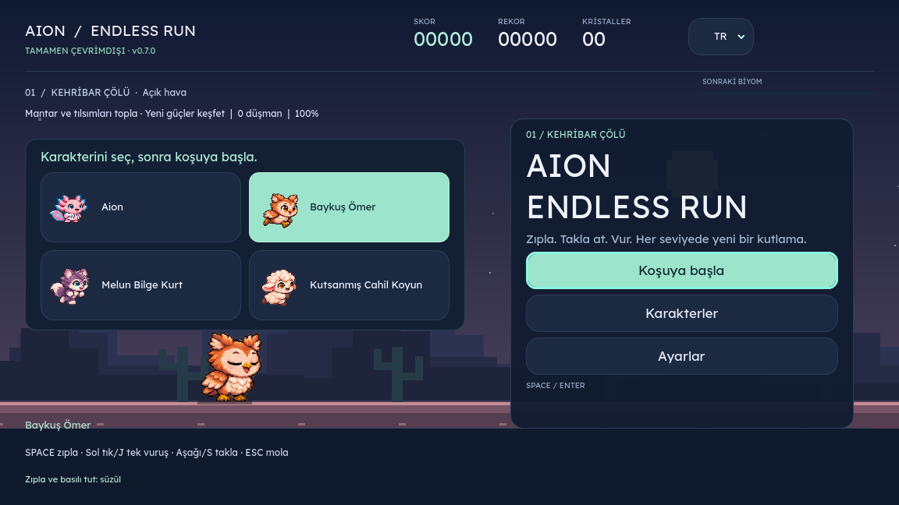

# Aion Endless Run

Sevimli bir piksel macerası. **Space ile zıpla, Esc ile mola ver.** Kargalara vur, engellerin altından takla at, dev mantar ve tılsımları topla, kendi rekorunu geç. Bağımsız Godot oyunu; Firefox veya eklenti gerektirmez. Oyun internete bağlanmaz.



**[Tarayıcıda oyna](https://aionendlessrun.vercel.app/) · [İndirilebilir sürümler](https://github.com/kaansavukduran/aion_endless_run/releases)** · [Sürüm ve platform durumu](docs/RELEASE.md) · [Doğrulama](docs/VALIDATION.md)

## Oyna

1. Releases sayfasından cihazına uygun dosyayı indir.
2. Windows: `Setup.exe` dosyasını açıp kur veya `portable.zip` dosyasını çıkartıp `AionEndlessRun.exe` dosyasına çift tıkla. Portable arşivi tümüyle çıkart; ZIP içinden çalıştırma.
3. Linux: `.AppImage` dosyasına çalıştırma izni verip aç. Debian/Ubuntu için `.deb` paketini kurabilir veya taşınabilir `.tar.gz` arşivini çıkartıp içindeki `AionEndlessRun.x86_64` dosyasını çalıştırabilirsin.
4. macOS: Intel ve Apple Silicon için universal `.app` taşınabilir ZIP veya `.dmg` vardır. İlk sürüm Developer ID ile imzalı/noter onaylı değildir; Gatekeeper açılışı engelleyebilir. Sistem korumalarını kapatmayı önermiyoruz.
5. Android: `.apk` dosyasını açarak kur. Yalnızca indirdiğin kaynağa güvendiğinde sistemin o kaynak için sunduğu yükleme iznini kullan. Paket arm64 ve x86_64 içindir; 32 bit Android desteklenmez.
6. iPhone: Bu sürümde App Store/TestFlight paketi yok. Apple Developer hesabı, dağıtım imzası ve mağaza/test onayı gerekir. Kaynak proje iOS hedefini içerir; web önizlemesi Safari'de alternatif bir oyun sürümüdür, yerel iOS kurulumu değildir.

Ana menüde **Koşuya başla** veya **Space**. Koşarken **Space**, Zıpla düğmesi veya boş alana dokunma ile zıpla. **Sol tık/J/Vur** ile tek saldırı yap; basılı tutmak tekrar saldırmaz; **aşağı ok/S/Ctrl/Takla** ile en az 0,68 saniyelik takla at; basılı tutarak sürdür. Düşerken düşmanın üstüne basarak sekebilirsin. **Esc** veya sağ üst **Duraklat** düğmesiyle mola ver. Yeniden Esc ile kaldığın yerden devam et. Oyun kumandasında A zıplama, X saldırı, B eğilme, LB kurt deparı, Start duraklatmadır. F11 tam ekranı değiştirir.

0.5.0’da **102 yeni karelik üç özgün piksel pafta** saldırı, eğilme, karga, kırmızı şapkalı cüce, eşyalar ve alçak dalı canlandırır. Aion yumruk atar, baykuş kanadını savurur, koyun kafa atar, kurt ısırır. Mantar 10 saniye büyütür ve cüce dalgası başlatır; şimşek, zaman kumu, kanatlı çizme, kalkan, mıknatıs ve can yaprağı geçici güçler verir. Keşfedilen yedi güç cihazda kaydedilir. Karışan karşılaşma torbası, değişen mesafe aralıkları, yumuşak hız değişimleri, yağmur/kar/kum/fırtına, küçük gök şimşeği, düşmana basma komboları ve kısa puan hedefleri koşuları çeşitlendirir. Hafif renk ve kamera efektleri Ayarlar’dan kapatılabilir. Telefon arayüzü her zaman yataydır; ekran kilidi desteklenmediğinde oyun alanı döndürülür. İki parmakla aynı anda zıplama ve saldırı çalışır. [Tasarım ve araştırma notları](docs/GAME-DESIGN.md).

Koyunların aralığı 112/224 piksele çıkarıldı; ilk hızda yaklaşık 0,35/0,70 saniye sonra, öndekinin zıpladığı noktada sırayla havalanırlar. Önceki 0.4 özelliklerinde koyunlar öndekinin izlediği zıplama yolunu mesafeye bağlı gecikmeyle sırayla takip eder. Kurt deparında kıvrılan rüzgâr izleri akar. Baykuş, görünür yükselen hava akımında basılı tutarak biraz yükselebilir. Bu hareketler için yeni 18 karelik ek pafta vardır.

Baykuş, kurt ve koyunun koşu/zıplama/donma/kül animasyonları ayrı 48 karelik paftalar kullanır. Web ve indirilebilir sürümün numarası sol üstte görünür. Eski web önbelleğinden geçiş otomatik yapılır; sonraki güncellemeler oyun içindeki düğmeyle açılır.

Her atlanan engel **+10**, her toplanan kristal **+25** puan. Mesafe de skor kazandırır. Hız zamanla artar ve sınırlandırılır. Kehribar Çölü ile Ayaz Vadisi mesafeye göre yer değiştirir; gündüz ve gece bir döngü oluşturur.

Aion varsayılan karakter. Başlangıç kartlarından Baykuş Ömer, Melun Bilge Kurt veya Kutsanmış Cahil Koyun seçilebilir. Hepsi ilk açılışta kullanılabilir. Aion iki kez zıplar; Baykuş Ömer tek zıplamadan sonra Space/dokunmayı basılı tutarak süzülür; koyun yerdeki arkadaşları toplayıp en fazla üç koyunluk sürü oluşturur ve her koyun bir can sağlar; kurt Shift veya karakterin üstüne basılı tutarak hızlanır. Kurtta basılı tutan parmak hızlanmayı sürdürürken ikinci parmakla başka bir yere dokunup zıplayabilirsin. Bir temasta bir koyun eksilir; son koyunda çarpışma koşuyu bitirir. Karakterini başlangıç ekranındaki dört görünür karttan seç. Koşu sırasında veya duraklatma menüsünden karakter değiştirilemez; yeni seçim için Ana menü’ye dön.

**TR / EN / CS** açılır dil menüsü başlangıç, duraklatma ve ayar ekranlarında bulunur. İlk açılış tarayıcı/cihazın ana dilini kullanır: Türkçe `tr`, İngilizce `en`, Çekçe `cs`; diğer diller İngilizce açılır. Otomatik seçim, oyuncu açıkça bir dil seçene kadar cihazı izler. Oyuncunun seçimi sonraki açılışlar için kaydedilir; eski geçerli dil tercihleri de korunur. **Ayarlar** menüsünde de üç dil, bağımsız ses, ekran efektleri ve dekoratif hareket seçenekleri ile ses düzeyi bulunur. Hareket kapalıyken karakter sabit poz kullanır, parçacıklar ve arka plan kaydırması kapanır; zıplama ve engellerin hareketi oynanış için sürer. Düğmeler Tab/Shift+Tab ve Enter ile kullanılabilir. Fare, dokunma ve klavye desteklenir.

Rekor, keşfedilen güçler ve tercihler yereldir. Geçici güçler yalnızca o koşuda sürer. Normal kayıt konumu Godot'un `app_userdata/Aion Endless Run/save.cfg` klasörüdür: Windows `%APPDATA%\Godot\app_userdata\Aion Endless Run`, Linux `~/.local/share/godot/app_userdata/Aion Endless Run`, macOS `~/Library/Application Support/Godot/app_userdata/Aion Endless Run`. Portable burada kurulum gerektirmeyen sürüm anlamındadır; kayıtlar işletim sisteminin kullanıcı veri klasöründe tutulur. Canlı koşu uygulama kapatılınca geri yüklenmez; rekor, seçili karakter ve ayarlar korunur.

## 0.7.0 · Takla, değişen saldırılar ve seviye kutlamaları

**164 yeni çizilmiş karelik dört özgün pafta:** sekiz saldırı dizisi, dört takla döngüsü, sekiz farklı yetişkin anime kutlama karakteri ve dört hareketli üst engel. Aion iki eliyle sırayla yumruk, baykuş sağ/sol kanat, kurt ısırık/kafa, koyun kafa/çifte kullanır. Her basış tek vuruştur; bir sonraki basış diğer harekete geçer. Sağdaki hedefe vururken komşu kareden arkaya taşan piksel parçası sıkı kare sınırlarıyla giderilir.

Her **900 mesafede seviye** artar. Farklı saç/kıyafetli sekiz karakter tekrar etmeyen bir torbadan seçilir; konfeti, yıldız, kalp veya baloncuklarla kutlar. Her **10 seviyede**, kahraman yere inince **1 saniyelik sarılma** olur: dünya, düşmanlar ve güç süreleri durur; sonra kalpler ve kısa dokunulmazlıkla devam edilir. Ayarlardan kutlamalar kapatılabilir. En yüksek seviye yerel olarak kaydedilir.

Mantar başlangıçta zorunlu değildir: ilk 20 saniyede çıkmaz, iki mantar arasında en az 45 saniye vardır; uygun eşya fırsatında varsayılan olasılığı **%2**. Ayarlarda %0–100 değiştirilebilir; bu değer saniye başına olasılık değildir. Devlikte düzensiz aralıklı küçük cüce grupları gelir; 4. seviyeden itibaren mantarsız da seyrek cüceler görülebilir. Devlik bittiğinde dalga cüceleri temizlenir ve kısa koruma verilir. Renk dalgaları ve hafif kamera için ayrı şiddet ayarı vardır; hızlı tam ekran flaş kullanılmaz.

Çöl ağacı, buz kemeri, yüzen rün ve mantar kemeri takla engellerini çeşitlendirir. Baykuşun rastgele hava akımı yukarı, ileri veya çapraz olabilir; ileri akım gerçek ilerleme hızını artırır. Daha küçük koyun takipçiler mesafeye göre gecikmeli zıplar ve takla atar. Üç dil, çevrimdışı kayıt/güncelleme ve önceki yetenekler korunur.

## 0.6.0 · Üç dil ve tutarlı karakterler

| Karakter | Türkçe | English | Čeština |
| --- | --- | --- | --- |
| Aion | Aion | Aion | Aion |
| Baykuş | Baykuş Ömer | Omar the Owl | Sova Omar |
| Kurt | Melun Bilge Kurt | Accursed Wise Wolf | Prokletý moudrý vlk |
| Koyun | Kutsanmış Cahil Koyun | Blessed Ignorant Sheep | Požehnaná nevědomá ovečka |

Dört kart oyuna başlamadan görünür. Koşu, zıplama, iniş, süzülme, yükselen hava ve depar kareleri orijinal PNG'ler değiştirilmeden opak karakter sınırlarına göre hizalanır; normal hareketlerde görünen yükseklik 90 mantıksal piksel kalır. Lider koyun normal, takipçiler %72 boyuttadır. Takla çizilmiş dönme kareleri kullanır; karakter dikey olarak ezilmez. **Yalnızca dev mantar gücü büyütür**; zıplama veya rüzgâr büyütmez. Savaş, yedi güç, rastgele karşılaşmalar, hava, iki biyom ve çevrimdışı güncelleme korunur.

## Kaynaktan çalıştır

Godot **4.6.3 standard** sürümünü kur. Bu depoyu indir ve Godot'ta `project.godot` dosyasını içe aktar. **F6 yerine F5** ile ana oyunu başlat. Komut satırı:

```sh
godot --path . --editor --import --quit
godot --path .
godot --headless --path . --script tests/test_game.gd
godot --headless --path . --script tests/test_adventure.gd
godot --headless --path . --script tests/test_localization.gd
godot --headless --path . --script tests/test_evolution.gd
```

Testler kullanıcı kayıtlarına yazdığı için kendi skorunu korumak istiyorsan testleri ayrı bir OS kullanıcısı veya geçici XDG veri klasörüyle çalıştır. Linux örneği:

```sh
XDG_DATA_HOME="$(mktemp -d)" godot --headless --path . --script tests/test_game.gd
```

Resmi export templates kuruluyken `export_presets.cfg` içindeki Linux, Windows, macOS, Android, Web ve iOS hedefleri kullanılabilir. Çıktı klasörlerini önce oluştur. `.github/workflows/build.yml` her ana dal gönderiminde test ve paket üretir; sürüm etiketi gönderildiğinde doğrulanmış işler tamamlandıktan sonra beta Release yayımlar. Android imza anahtarı kaynak kodda değildir; depoya ait iki Actions secret ve `AION_ANDROID_SIGNING_READY=true` repository variable gerektirir. Ayrıntılar [paketleme notunda](docs/BUILD.md).

## Görsel kaynaklar

FireAxolotl ve FireAxolotl Extension'daki orijinal Aion koşu paftası ve karakter paftaları PNG içerikleri değiştirilmeden korunur. 0.3.0'da baykuş, kurt ve koyunun her biri için Aion tarzında 6×8 (48 kare) ayrı piksel pafta eklendi: bekleme, koşu, zıplama, donma, ateş/duman, kül, yetenek ve iniş. Donma ve kül de artık her karakterin kendi çizilmiş kareleridir. Koşu adımları mesafeye bağlıdır; baykuşun süzülmesi ve kurdun deparı ayrı döngüler kullanır. Kare bölgeleri, hizalama noktaları ve özgün PNG SHA-256 değerleri `assets/FULL-RUNNER-PROVENANCE.json` dosyasındadır. Önceki paftalar kaynak geçmişi için korunur.

[Kaynak ve lisans kayıtları](THIRD_PARTY_NOTICES.md). Chrome dinozorunun görseli veya kodu alınmadı. Hesap, reklam, telemetri, çevrimiçi puan tablosu veya ücretli kilit yok.

## English

A standalone offline Godot runner. **Space / tap to jump, Esc to pause.** Four available characters, fire and ice collisions, local best score, collectible crystals, two scrolling biomes and a day/night cycle. Choose **TR / EN / CS** in the header or change language in Settings. First launch follows the primary browser/device locale; unsupported locales use English. Explicit choices persist. Version 0.7.0 adds 164 generated sprite frames, alternating single-press attacks, drawn ground rolls, distance levels, eight varied adult anime celebrants, a one-second world-frozen hug every ten levels, configurable rare mushrooms, irregular gnome crowds, four overhead barriers, and upward/forward/diagonal owl winds. Smooth color/camera intensity and celebrations can be adjusted separately. Version 0.6.0 adds full Czech localization, exact localized character names, visible pre-run character cards, a locked character during each run and normalized pose sizes. Following sheep are smaller; only mushroom power enlarges the hero. Download installers and portable editions from Releases. Version 0.5.0 adds four distinct melee attacks (left click/J), ducking (Down/S/Ctrl), crows, enemy stomps, giant-mushroom gnome waves, seven collectible powers, changing weather/tempo, short goals and 102 new sprite frames. Sheep follow at clearer spatial delays. Phones always render a landscape playfield with multi-touch controls. Gentle camera/lightning effects can be disabled. Flowing wolf wind and real owl updraft lift are retained. The 48-frame companion sheets, species-specific freeze/ash animations and offline update migration are retained. Abilities include Aion double jump, hold-to-glide owl, collectible sheep lives (up to three) and hold-to-boost wolf. This remains a playable beta. macOS builds use development ad-hoc signing, without Developer ID/notarization; native iPhone distribution requires the owner's Apple Developer signing and App Store/TestFlight setup. See the release notes for actual platform verification, rather than assuming every produced package was device-tested.

## Vercel

[Adım adım Vercel kurulumu](docs/VERCEL.md). GitHub deposunu Vercel hesabında içe aktar, **Other** seç ve **Deploy** düğmesine bas. `vercel.json` derleme komutunu ve çıktı klasörünü belirler. MCP, API anahtarı veya veritabanı gerekmez. Vercel web oyunu içindir; kurulum paketleri Releases bölümündedir.
