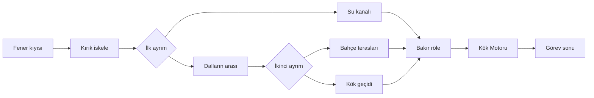

# Sönen Fenerler · İlk arcade görev

Bu mod mevcut Godot 4.6.3 oyununa eklenir. Sonsuz koşunun otomatik hareketi, 15 saniyelik seviyeleri, beş seviyede bir boss takvimi ve kayıtları değiştirilmez. Yeni modun sonlu haritası, elle hareketi, kontrol noktaları ve görev sonu vardır. Görev 2–5 yalnız plandır; bu sürüm Metal Slug 3'ün bütün uzunluğuna veya üretim hacmine ulaşmış sayılmaz.

## Oynama yolu

Ana menüde karakterini seç → **Arcade** → **Göreve başla**. Önceki tamamlanmamış görev varsa kontrol noktasından sürdürme ayrı düğmedir. Kısa yardım sayfaları atlanabilir.

Kıyı → iskele → ilk ayrım:

Her son rotada bir Kök Bekçisi mini boss’u vardır. Normal düşmanlar tek vuruştur; mini boss 12, ana boss 90 candır. Kırmızı şapkalılar yaklaşır, böcekler yüklenir, kargalar dalar, uçan sporlar düşer, gözcü dronlar ikili atar, tohum makineleri nişan alır. Yukarıdan basılan normal düşman tek darbede yenilir ve kahraman seker. Son karşılaşmada tohum salvosu, atlanabilir kök dalgası ve dron çağrısı üç evreyle sıklaşır. Boss görünür menzile yaklaşınca konuşma açılır; konuşma bitmeden saldırmaz ve hasar almaz. Zafer animasyonu sonuçtan önce kısa süre tamamlanır.

Düşman aralıkları ve sonraki türleri koşunun tohumu ile çeşitlenir. Kontrol noktasından denemede aynı düzen geri gelir. Köprüler, güvenli sıçrama yüzeyleri, boşluklar ve rota bağlantıları rastgele bozulmaz. Başlangıçtaki dört rol öğrenilebilir kalır.

## Kontroller

| Eylem | Klavye/fare | Dokunma | Standart Xbox / PlayStation |
|---|---|---|---|
| Sağa/sola hareket | A/D veya ←/→ | Soldaki sabit joystick | Sol çubuk veya yön tuşları |
| Zıpla / özel sıçrama | Space, tut/bırak | Zıpla, tut/bırak | A / ×, tut/bırak |
| Ateş / yakın vuruş | F, J veya sol tık | Ateş / Vur | RB / R1, RT / R2 veya X / □ |
| Enerji bombası | G, her yeni basışta bir | Bomba | B / ○ |
| Bin / in | E | Bineğin yanındaki düğme | Y / △ |
| Melun depar | Shift | Joystick'in dış bölgesi | LB / L1 |
| Duraklat | Esc | Üstte II | Start / Options |

Yeni modda Takla yoktur. Eski Takla eşlemesi bu modun Bomba eylemine karşılık gelir; sonsuz modun ayarı değiştirilmez. Yeniden atanmış kol düğmeleri korunur; bin/in için kalan boş yüz/omuz düğmesi kullanılır. Yardım bu gerçek eşlemeyi gösterir. Menüde A/× veya X/□ seçer; yön tuşları ve sol çubuk odak değiştirir. Görsel nişan şu aşamada kahramanın baktığı yatay yöndedir; uçan hedefler için sıçrama/platform kullanılır.

Aion çift sıçrar. Ömer basılı tutunca süzülür; havada bırakıp yeniden basınca üç ek kanat hakkı kullanır. Emre ve Eren yerde basılı tutarak 1,2 saniyeye kadar güç biriktirir, bırakınca sıçrar. Melun depar yapar. Kutsanmış'ın kurtarmalarla kazanılan küçük takipçileri en fazla üç kişilik sürü oluşturur ve gecikmeli hareket eder; binekte arka basamağa alınırlar. Ana kahramanın tasarımı sıra numarasından değil atlas kimliğinden çözülür.

## Ödül, silah ve kayıt

- Temel tabanca sınırsız, 0,32 saniye aralıklıdır. Yakında tek bir temas saldırısı, animasyonun temas anında hasar verir. Aynı yakın vuruş basılı tutularak tekrarlanmaz.
- Enerji bombası fiziksel yay çizer, sınırlıdır ve alan etkisi yapar. Rengi Aion pembe, Kutsanmış krem, Melun mor, Ömer kehribar, Emre turuncu, Eren turkuazdır.
- İkmalde saçma, üç hedefe kadar delen ark, kalkan, can, bomba ve binek tamiri vardır. Özel silahın 36 atışı bittiğinde temel tabanca geri gelir; doldurma ekranı yoktur.
- Meyve 25, normal düşman 100, mini boss 500, bekçi kurtarma 300 puandır. Kurtarma bir can ve bir bomba da verir; görev sonunda ayrıca kurtarma bonusu vardır. NPC dost ateşinden zarar görmez.
- Kızak dört zırha sahiptir, daha güçlü atar ve boşlukların üzerinde süzülür. Hasarı önce kendi zırhı alır. Binme/inme ve zırh göstergesi gerçektir.
- Kontrol noktası her yeni alanın başıdır. Yeniden denemede alanın başına dönülür; verilmiş puan ve kurtarma ödülleri tekrar üretilemez. Yeni görev taze süre ve puanla başlar. Kampanya rekoru ayrı korunur.
- `user://campaign.json` ve webde ayrı `aion.campaign.v1` aynası kullanılır. Mevcut `save.cfg`/sonsuz koşu tarayıcı kaydı silinmez. Yazma hatası başarı diye sunulmaz; yeniden kaydetme düğmesi vardır.

## Uygulama sınırları

Yeni kod: `campaign_world.gd` kurallar; `campaign_view.gd` mevcut sanat ve yeni makinelerin çizimi; `campaign_game.gd` giriş, menü, kamera ve kayıt; `campaign_text.gd`/`assets/locales/campaign.json` on bir dil; `campaign_art.gd` bağımsız dokulu kareler. Eski dünya yeni moda dönüştürülmez.

62 önceki PNG'nin tamamı başlangıç commit’iyle aynı baytlardır. Üç yeni AI destekli, kullanıcı yetkisiyle üretilmiş pafta 48 makine + 36 yakın saldırı çizimi içerir. Eşit hücre varsayımı yerine gerçek alfa boşlukları kesilir; koyunun ayrı halesi korunur, komşu satır parçaları alınmaz. En büyük gerçek gövdenin ayak pikseli zeminle karşılaştırılır. Teknik doğrulama yeni çizimlerin kullanıcı tarafından estetik olarak onaylandığı anlamına gelmez.

Fiziksel Poco, iPhone, Xbox/PS kolu ve yeni iOS paketi bu çalışma ortamından denenmiş sayılmaz. Gerçek tarayıcı oynanışı, çizim için kurulmuş test sahneleri ve kaynak testleri teslim raporunda ayrı belirtilir.
