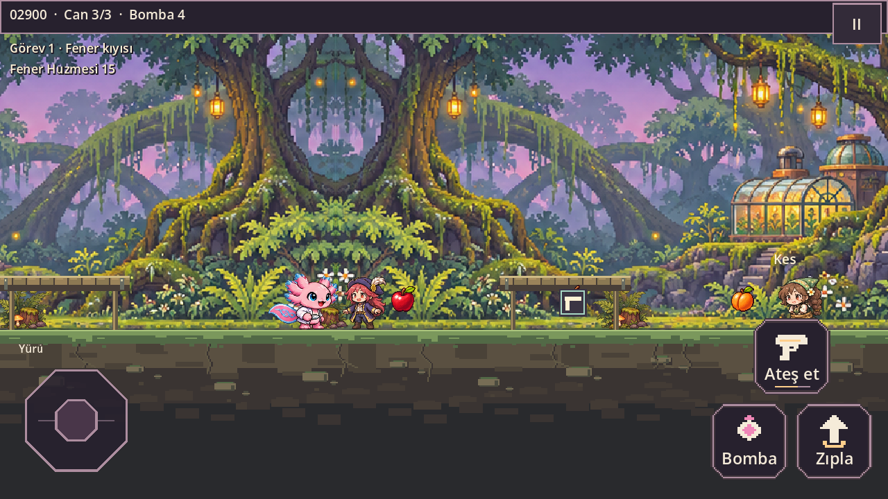
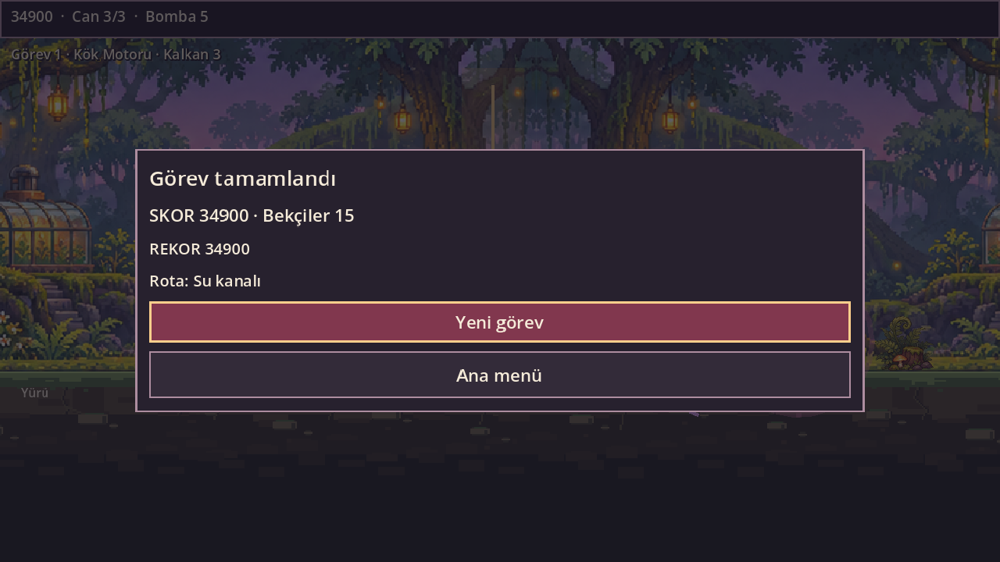

# Mission 1 · Yerel 0.24.0 doğrulaması

**Yerel aday `3639f7fe926a22c1`; yayınlanmadı.** Başlangıç `90055c5abf7e339c4cf30ad698f8c9f6383b59ae`, dal `feat/keeper-rescue`. Testler değiştirilmiş çalışma ağacında yapıldı; eski commit'in birebir kopyası olarak etiketlenmedi. `2026-11-14T22:58:53.209300+03:00` / Europe/Istanbul. Kaynak dosyalarının içerik envanteri [tested-source.json](tested-source.json) içindedir.

[İçerik, varlık ve mühendislik envanteri](../CAMPAIGN-EXPANSION.md) · [makine özeti](verification.json) · [web manifesti](web-build.json).

| Kontrol | Sonuç | Gerçek kapsam |
|---|---|---|
| Kaynak regresyonu | PASS · 29 paket / 20.677 kontrol | Eski sonsuz koşu, yetenekler, kayıtlar, dil, giriş, yeni içerik; [tam sonuç](source/source-results.json) |
| Altı kahraman × üç rota | PASS · 18/18 | Gerçek dünya eylem API'si ile model koşuları; [ham sonuç](model-playthroughs.json). Tarayıcı veya insan oynanışı diye sunulmaz. |
| Gizli yan odalar | PASS · 36 yaklaşım | 6 kahraman × 3 rota × 2 oda, gerçek sıçrama/şarj/kesme. Kurulmuş başlangıç noktası, kaldırılmış düşmanlar; geometri korunur. |
| Sprite / arayüz render | PASS · 48 kontrol | Altı bıçak döngüsü, ayak teması, bölge/araç/muhafız/boss ve iki yön; [fixture görüntüleri](screenshots/fixtures/). Kaynak suite ayrıca 659 bağımsız örneği ve gerçek gövde ayaklarını denetler. |
| Firefox gerçek oyun | PASS · 88 kontrol | Ana menü → kıyı → iskele → su → röle → Kök Motoru → sonuç → eski menü → offline. 15 gerçek NPC kurtarması, sıfır ölüm/yeniden deneme, sıfır betik hatası; [koşu](browser/firefox/playthrough.json). Bütün 22 NPC bulunmuş sayılmaz. |
| Chromium gerçek giriş | PASS · 30 kontrol | Dokunma/çoklu dokunma, yön değiştirme, gerçek NPC kesme/ödül/kayıt, offline yeniden açılış; [sonuç](browser/chromium/results.json), [gerçek video](browser/chromium/rescue-and-offline.webm). Güncel tam görev bu tarayıcıda tamamlanmış sayılmaz. |
| Yeni müzik regresyonu | PASS · 3 WebAudio kontrolü | Aynı duraklatma/devam senaryosu: eski aday 118 uzun sample başlangıcı, yeni aday 0; parça 1 kez başlar. [Önce](audio/before.json) / [sonra](audio/after.json). |
| Sahne ömrü | PASS · dört giriş/çıkış | Düğüm sayısı 1 → 1,1,1,1; ek orphan yok. GPU/WASM RAM testi değildir. |
| Eski resimler | PASS · 65/65 | [Bayt bütünlüğü](original-art-integrity.json). Hiçbir eski PNG yeniden çizilmedi veya ezilmedi. |
| Paketleme sözleşmeleri | PASS · 14 fixture testi | 7 web, 4 Android, 3 macOS mock testi. Mac logundaki Resource busy / no space metinleri beklenen sahte hata senaryolarıdır; yeni gerçek paket kurulumu değildir. |
| 60 FPS hedefi | FAIL · bu yazılımsal ölçümde | Firefox/llvmpipe 1280×720 DPR1, 6 s etkin dünya: ortalama 54.35 FPS, medyan 16.92 ms, p95 33.28 ms. Fiziksel GPU/telefon sonucu değildir. |
| Hedef cihaz / gerçek kol | NOT TESTED | Poco X7, iPhone, Xbox/PS; yeni imzalı mobil veya masaüstü kurulum paketi de üretilmiş sayılmaz. |
| 9–13 dakika keşif | NOT TESTED | Hızlı gerçek tarayıcı botu 304.69 s duvar zamanı, 299.30 s aktif model zamanı; bütün sırları toplamamıştır. İnsan süresi/hedef başarısı değildir. |
| GitHub/Vercel/Pages yayını | YAPILMADI | `writing-block.md`: “dışa yayın ayrı onay gerektirir.” Main push, merge, release veya deploy yapılmadı. |

## Gerçek görüntüler





Fixture dosyaları özellikle kurulmuş sahnelerdir; ordinary-input browser görüntüleriyle karıştırılmamalıdır. Sprite kaynakları AI destekli üretildi. Teknik kontroller, yeni sanatın kullanıcı tarafından estetik veya kanonik olarak onaylandığı anlamına gelmez.

## Uzun testte bulunan bellek hatası

Önceki adayda uzun WAV'ın `playing` durumuna her karede bakılması tekrar tekrar WebAudio örneği oluşturuyordu. İlk probun 126 sayımı ayrı tanı kaydıdır; aynı girdilerle tekrar edilen kalıcı regresyonda **118 → 0** uzun sample başlangıcı ölçüldü. Başlatma parça değişimi/sesi açma sınırına taşındı; müzik ve kısa efektler stream oynatır. Pause/mute/yeniden açma sayacı da kaynak testindedir.

Önceki tek Firefox uzun testi 16 GiB ortam limitine ulaşıp OOM ile öldü. Düzeltilen adayın tüm görev + offline koşusunda örneklenmiş **bütün ortam** zirvesi 3.73 GiB, yeni OOM-kill sayısı 0 oldu. Bu, telefon RAM ölçümü veya oyunun tek başına RAM'i değildir; ilk FPS örneğinden sonra headless doğrulamalar da aynı ortamda çalıştı. [Bellek örnekleri](browser/firefox/environment-memory.json), [önceki gerçek hata](diagnostics/pre-fix-firefox-oom.json) saklanmıştır.

Daha önceki model denetleyicileri yanlış sırada bomba kullanma, şarjlı sıçrama zamanlaması ve boş kapının önünde atlamama nedeniyle tamamlanmadı. Bu koşular final PASS diye yeniden etiketlenmedi. Son denetleyici normal hareket, ateş, bomba ve sıçramaları kullanır; boss konuşmasını UI sınırında onaylar. Ölümsüzlük, düşman silme, ileri ışınlanma, can değiştirme veya doğrudan boss hasarı yoktur. Son 18 koşuda tekrar sayıları ve süreler ham JSON'dadır; bazı denemeler ölerek tekrar eder.

## Yeniden çalıştırma

```sh
godot --headless --editor --import --quit
python3 packaging/run_source_tests.py
AION_PLAY_RESULTS=build/model-routes.json godot --headless --script tests/play_campaign_expansion.gd
python3 packaging/build_web.py
python3 -m http.server 8765 --bind 127.0.0.1 --directory build/web
# Ayrı terminal; fiziksel telefon testi değildir:
python3 tests/browser_campaign.py --url http://127.0.0.1:8765 --evidence build/chromium-review --expanded-rescue --rescue-only --offline
python3 tests/browser_campaign.py --url http://127.0.0.1:8765 --evidence build/firefox-review --browser firefox --expanded-rescue --play-through --route water --offline
python3 tests/browser_campaign_audio.py --url http://127.0.0.1:8765 --evidence build/audio-review
```

Grafik sürücüsü olmayan makinede önce desteklenen WebGL2 kurulmalıdır. Buradaki GL ANGLE tanısı bu desteği sağlayamadı ve BLOCKED kaydedildi; çalışmış oyun gibi raporlanmadı. Aktif telefon kontrol şeması solda sabit joystick, sağda zıpla/ateş-yakın vuruş-kesme/bomba, bağlamsal bin/in olarak korunur.
