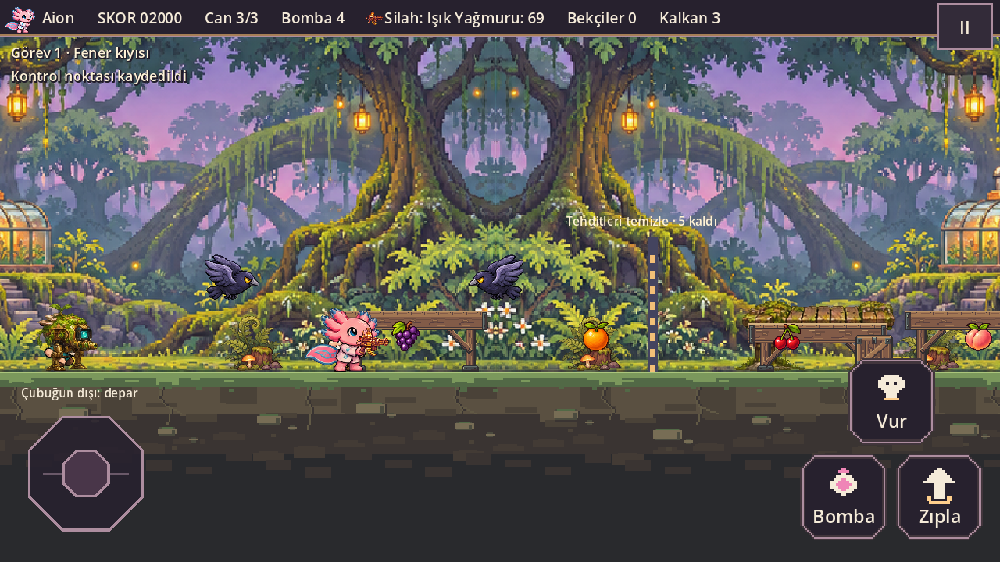
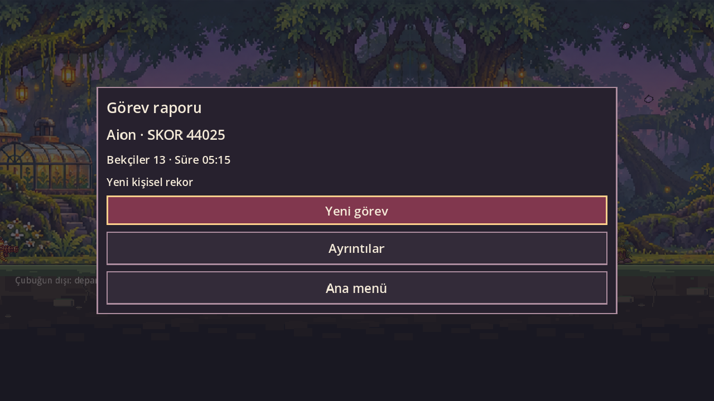

# 0.28.0 · Mission 1 rhythm and recovery

Baseline: clean main `a1d7cc483973dc48f1e8837dbcce807c4c9fc291` (0.27.1), Godot 4.6.3. Scope: the owner's acceptance of the six gameplay recommendations. No new engine, hero redesign, input remapping, save deletion or automatic Drive synchronisation. Existing four playable identities, owl/wolf assists, TR/EN, mounted gifts, directional guns and old endless mode remain.

## Implemented gameplay

1. **Encounter decisions.** Ground chasers, flying pressure and high/low seed shots are combined in authored groups with three bounded, seeded spacing variants. High shooters have actual supporting platforms. The long leaf routes use eight closer groups, while intermediate non-leaf encounters no longer repeat a full mandatory gate. Gate text reports the actual living blockers, with at most three world/edge direction cues. Normal enemies remain one-hit; existing armoured heavies and guardians retain their established rules.
2. **Learnable guns.** First-shore crates focus on heavy/arc weapons with support items between them. Different specials stay as physical pickups until the existing E / gamepad Y / contextual touch button chooses Swap. Matching stock adds ammo up to two magazines. Pistol-to-special and vehicle-contact collection stay automatic. NPC thanks, bag extraction, drop and real contact are preserved; no remote gift award.
3. **Hit feedback.** Enemy-defeat events now reach the actual sound path, with a separate armour-hit timbre and a short rate limit. Optional 35 ms simulation hold is capped to once per 180 ms and disabled by reduced motion or disabled motion. No camera or character-anchor movement is introduced.
4. **Recovery.** Real route flags capture safe ground positions and stock. Retry/Continue restore the recorded position, gun, ammunition, shield, flock and vehicle state; score and one-time claim IDs are not rolled back. Section-entry recovery keeps the old parked-vehicle rule. A real zero-score supply supports pistol/low-ammo retries. Destroyed vehicles stay destroyed if already destroyed in the snapshot. Old saves without rally data fall back to their section start; malformed new fields are rejected before mutation.
5. **Setpiece and boss.** The first shore includes two 2.4-second warning decks over a physical gap. Standing on a deck starts its own countdown; falling/respawn uses existing physics. Retry rebuilds them. Root Engine has optional destructible ports that remove corresponding fan shots, an aimable exposed core for bonus damage and a telegraphed physical final charge that can be jumped. Ordinary body shots still work; ports are not mandatory locks.
6. **Skill score.** Distinct defeats within four active seconds build a bounded bonus, with extra close-strike/stomp credit. Pause does not eat the window. Damage/expiry resets the temporary chain without deleting earned score. Existing one-time IDs prevent farming the same enemy. Up to five short score popups and optional reachable fruit arcs reward risk; no extra HUD bar. Best chain joins the existing mission report.

## Verification scopes

- [Fresh 56-suite source results](source-results.json): **38,358 checks, zero failures**. Engine/model/small-scene assertions include all previous suites and 112 new rhythm checks. These are not human play sessions or hardware-device tests.
- [New regression log](campaign-rhythm.log): actual shared actions, gun choice/refill cap, mounted collection, checkpoint death/retry/serialization, legacy fallback, invalid save rejection, no duplicate rewards, zero-score recovery kit, active-only chains, supported flags, every playable hero crossing the bridge, projectile-to-port collision, exposed core, telegraph/dash/jump and actual Game audio/reduced-motion path.
- [Packaging tests](packaging.log): 11 contract/mock tests pass. Fixture versions in this log belong to the packaging fixtures, not the current exported game.
- Normal-input web and native render evidence is recorded separately below. Render fixtures deliberately stage positions; they must not be described as normal traversal.

The first local attempts caught real test/setup mismatches: a fresh-world helper still sat in briefing; a supply-only assertion also collected adjacent fruit; old NPC multi-gift tests assumed forced gun replacement; old group-count/fruit-height assertions did not describe the newly reachable platforms. Tests now exercise the shared deliberate interaction and real support geometry. A genuine entry-retry regression was fixed by parking the carried vehicle at section entry, preserving the old invariant. A destroyed recorded vehicle is no longer replaced with a fresh authored hull.

Native render setup initially lacked a working X display, then used a temporary extracted Debian Xvfb binary with writable XDG directories. The first fixture wrongly queried base pit-floor height instead of one-way support and compared UI coordinates without the actual screen transform. Its corrected assertions use the real collision query and transformed touch rectangle. These exploratory failures are not counted as passes.

No physical Poco/iPhone/Xbox/PS controller or human enjoyment study was performed. Synthetic Gamepad API input is labelled synthetic. Browser automation demonstrates functioning mechanics and completion, not that every player will find the difficulty optimal. Mission 2–5 remain outside this change.

## Ordinary-input acceptance

The local exported candidate `3a77349cbc99cbf2` completed **52 browser assertions with zero engine/browser script errors**, including the full shore → quay → physical lower fork → water → relay → arena → boss → result flow. The successful traversal took 420.73 seconds wall time after the initial input checks, used **zero retries**, and finished through ordinary movement, aiming, firing, grenades and jumps. No teleportation, enemy deletion, state injection or invulnerability was used. This is one route with Aion, not all branches/heroes or a human exploration-time claim.

The same run tested actual multitouch, portrait rotation, cancellation, Shift, right-click grenade, intermediate-angle bullets, virtual Xbox pause/confirm/fire/jump/grenade and ten deliberate E weapon changes. It performed a real offline reload after a mid-route checkpoint, resumed through the actual Continue action and checked saved position/gun/ammo. A second offline reload after completion preserved the separate campaign checkpoint. [52 checks](browser-results.json), [full traversal receipt](playthrough.json), [offline before/after](rally-offline.json), [raw log](browser.log).



[WebAudio lifecycle](audio.log): 3 checks pass; one intended music start, no repeated long buffer allocation during actual paused/playing/paused transitions. No new performance target is claimed from this concurrent software-rendered test environment.

The final native presentation refinement adds stepped bronze vent casings and exposed-core brackets. It changes only boss drawing, not the gameplay model used by the above complete run; focused source tests, staged renders and the final public opening are recorded separately.

## Final presentation and regression pass

Seven deliberately staged native Godot screenshots passed **18 render assertions**. They show the actual gun-choice button, rally return, failing bridge, port/core/charge stages and portrait layout. [Render log](native-render.log), [portrait gun choice](portrait-offer.png), [boss ports](boss-ports.png), [bridge](failing-bridge.png). These are native renders of real game objects, not normal-input traversal evidence.

Visual review caught a real portrait overlap: the context gun-choice/ride target touched the manually routed Fire target. Its portrait size/position now leaves the joystick and all three actions separate; the new regression covers four viewport sizes. The rhythm suite now contains **112 assertions**. A focused post-refinement run passed 1,583 checks across rhythm/UI/presentation; final complete source run is recorded in the final results file.

[Forge browser log](forge-browser.log) and [51-check receipt](forge-browser-results.json) additionally cover opening, four hero choices, dark theme, large/rotated menus, Attract isolation, crouch+move+fire, all eight aim directions, normal projectile rescue → roam → contact → thanks → physical bag gift, with zero script errors. These are real ordinary inputs; the controller portion explicitly uses a virtual Gamepad API object.

Final package contracts: [Web 7](web-packaging.log), [Android 27](android-packaging.log), [macOS 3](macos-packaging.log), all pass. These contracts do not constitute a signed new native release or a physical-device test.



Final local export: **0.28.0 / `3015b0de059c5e13`**. Publication must be bound to the actual pushed commit, build manifests and CI run, not a stale previous READY deployment. Final delivery records the independently checked Vercel/Pages addresses.

[Final-export browser regression](final-browser-results.json): **36 checks, zero errors**, build `3015b0de059c5e13`. This repeats actual combat/touch/multitouch/cancellation/rotation/synthetic-Xbox and real-worker offline Continue after the final portrait-target fix. [Raw log](final-browser.log).

Reproduce:

```sh
python3 packaging/run_source_tests.py --output build/test-results
python3 packaging/build_web.py
python3 -m http.server 8798 --bind 127.0.0.1 --directory build/web
# Separate terminal, server still running:
python3 tests/browser_campaign.py --url http://127.0.0.1:8798/ --evidence build/rhythm-browser --combat-controls --play-through --route water --rhythm --offline
python3 tests/browser_forge.py --url http://127.0.0.1:8798/ --evidence build/forge-browser --scenario all --rescue
AION_RHYTHM_REVIEW=build/rhythm-review xvfb-run -a godot --audio-driver Dummy --script tests/render_campaign_rhythm.gd
```
