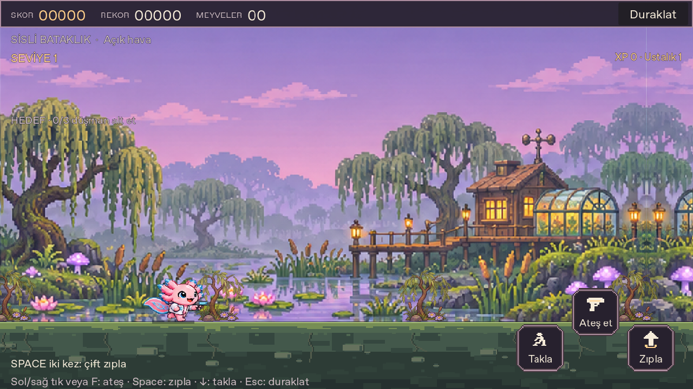

# Yol ve zemin çizimi

Önceki çizim tek renk dolgu, iki düz kenar şeridi ve 43 pikselde bir tekrarlanan kısa çizgilerden oluşuyordu. Ayrıntılı arka planla arasındaki görsel kopukluk kaynak kodda ve gerçek oyun görüntüsünde doğrulandı.

Yeni zemin altı biyom için ayrı pixel-art malzeme kullanır: kumtaşı, kar/buz ve arduvaz, yosunlu bataklık toprağı, aşınmış şehir taşları, orman kökleri ve bazalt. Üstte okunaklı bir basma kenarı, altında gömülü taşlar ve kırılan toprak katmanları vardır. Alt bölüm, kontrol ve yardım metinlerini bastırmamak için daha sakin tutulur. Yeni dış görsel, bağımlılık veya oyun mekaniği eklenmedi.

[Çöl](screenshots/biome-0.png) · [Kar](screenshots/biome-1.png) · [Şehir](screenshots/biome-3.png) · [Orman](screenshots/biome-4.png) · [Bazalt](screenshots/biome-5.png) · [Dikey telefon](screenshots/mobile-393x873.png) · [Yatay telefon](screenshots/mobile-873x393.png) · [Çukur](screenshots/pit.png) · [Biyom geçişi](screenshots/biome-transition.png).

Bu görüntüler açıkça seçilmiş görsel inceleme sahneleridir. Oyuncunun bu seviyelere doğal koşuyla ulaştığı iddia edilmez. [Eski zemin](screenshots/marsh-before.png) aynı pencere boyutunda kaydedildi; eski görüntüdeki CS/büyük yazı tercihi ile yeni TR/normal yazı farklıdır. Karşılaştırma arayüz tipografisinin birebir ölçümü değildir.

- [1.136 ilgili kaynak kontrolü](source-results.json): 146 yeni zemin kontrolü; oyun, boss/çukur, hareket ve önceki yetenek regresyonları.
- [40 gerçek çizim kontrolü](render-results.log): altı biyomda görünür destek çizgisi, gerçek çukur açıklığı, yüzde 50 biyom karışımı ve telefon yön değişimi.
- [88 normal tarayıcı girişi](browser-results.json): Aion/Ömer/Kutsanmış koşu, ateş ve takla; Melun deparı; gerçek menüler, tema, yazı büyütme ve ekran boyutları. Yazılım Gamepad API girdisi fiziksel kol değildir.

İlk görüntü testinde pencerenin ölçek dönüşümü hesaba katılmadığından yanlış pikseller örneklendi. Test, gerçek viewport dönüşümünü kullanacak şekilde düzeltildi; karakter konumu değiştirilmedi. Biyom karışımında yeni yarı saydam dolgunun ikinci kez üst üste karıştırılması da çizim aşamasında giderildi ve gerçek yüzde 50 rengi sınandı.

Kahraman görselleri, fizik, çarpışmalar, kayıtlar ve onaylı kontrol düzeni değiştirilmedi. Fiziksel telefon veya kontrolcü testi yapılmadı. Yerel, CI ve yayımlanmış sonuçlar [teslim kaydında](verification.json) ayrı tutulur. Bu web güncellemesi mevcut 0.22.0 indirme paketlerini değiştirmez.
