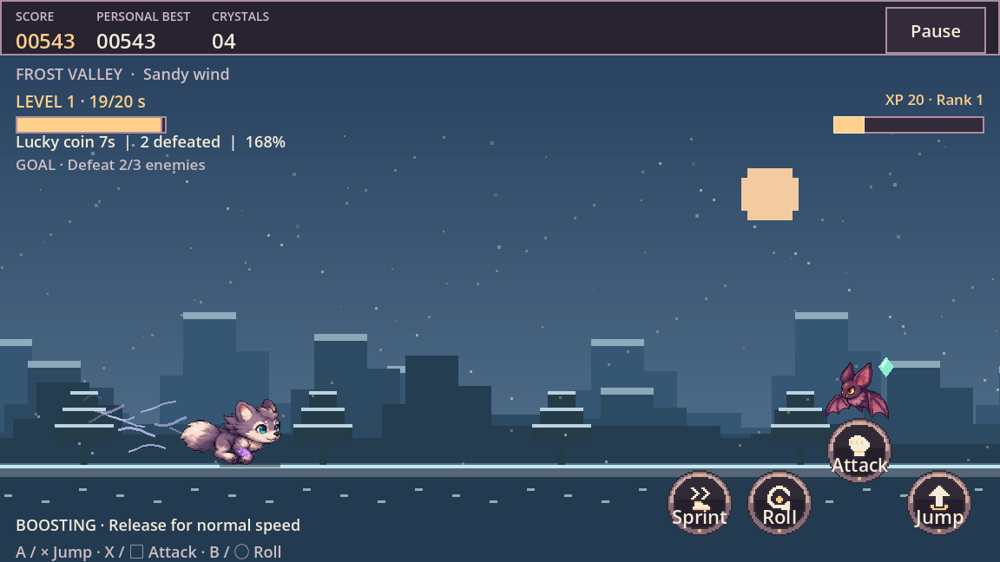
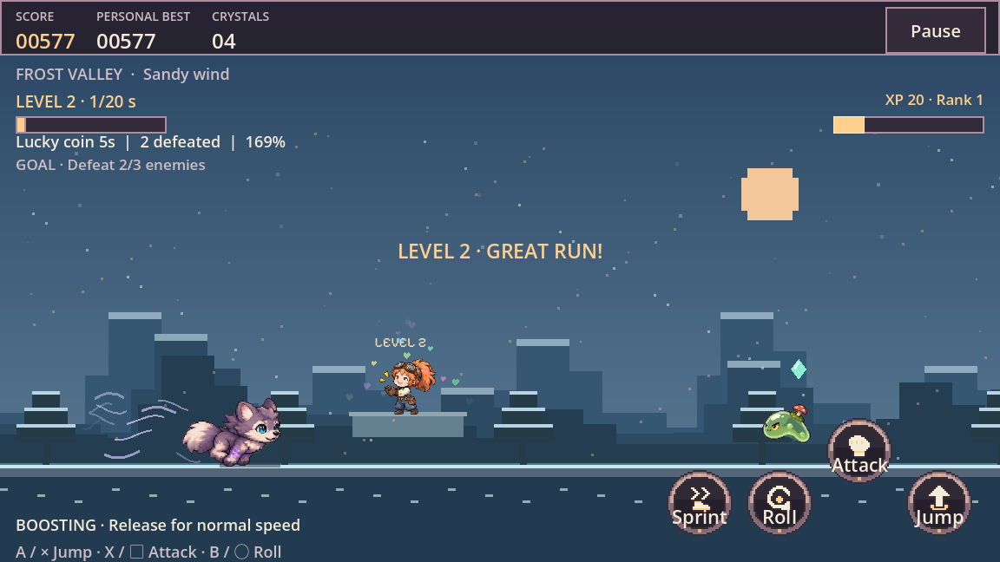
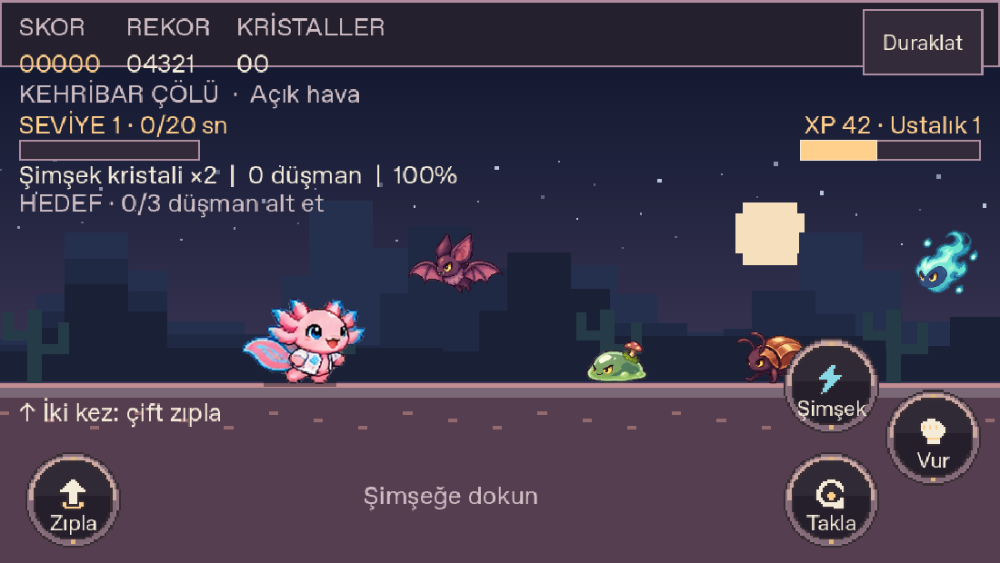
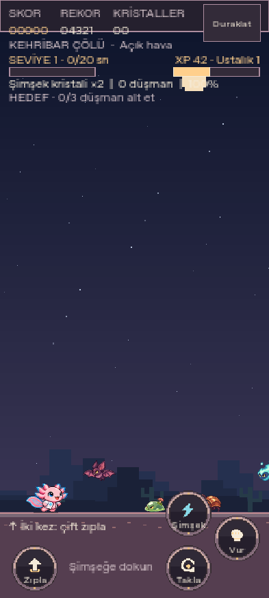

# 0.15.1 görsel iyileştirmesi

Dört yeni düşmanın kaba geometrik çizimleri ayrıntılı sprite animasyonlarıyla değiştirildi; mevcut kahraman tasarımları korunur. Telefon tuşlarının her çeyreği aynı integral piksel maskesini kullanır. İkonlar ve çerçeveler önbelleğe alınır; dokunma sınırı çizilen siluettir.

- 14 kaynak/sahne paketi: **3604 başarılı kontrol**. Yeni hedefli 152 kontrol; simetri, gerçek dokunma sınırı, farklı kareler, şeffaf kenarlar, sabit yüz/zemin ve ölçek.
- Gerçek tarayıcıda **29** animasyon/giriş/yön testi son yerel web derlemesinde geçti. Aion çift zıplama, baykuş süzülme, kurt deparı, koyun takipçileri, saldırı, takla, iptal ve çoklu dokunma korunur.
- **6** normal girişli rastgele karşılaşma kontrolü; altı biyom ve dört yeni düşman görülür. Bu tur aynı nihai düşman atlası ve önceki tuş görselleştirme derlemesindedir. Model durumunu değiştiren test API'si kullanılmaz.
- 40 önceki PNG başlangıç commit'iyle byte-byte aynıdır. Yeni PNG değişmeden saklanır; kayıt betiği yalnız metadata üretir.

Aşağıdaki görüntüler gerçek Godot oyun renderer'ından, dört düşmanı aynı karede karşılaştırmak için **bilinçli olarak yerleştirilmiş görsel test sahnesidir**. Rastgele normal koşu kanıtı olarak sunulmaz.

İlk yoğun yazılımsal render turunda 5 saniyelik süzülme örnekleme beklemesi doldu. Değişmemiş testler son derlemede 29/29 geçti; eşzamanlı render yükünün kesin payı izole edilmedi. Sonuçlar ve kapsam [verification.json](verification.json) içindedir. Fiziksel Poco veya fiziksel oyun kolu denendiği iddia edilmez. CI ve indirilebilir paketlerin sonuçları aşağıdadır.

Canlı Firefox 153.0 üzerinde altı kontrol geçti: doğrulanmış PCK açılışı, Aion yatay referansı, gerçek dokunmayla saldırı/takla, koşuyu koruyan yön değişimi ve hatasız çalışma. API30 Android emülatöründe yedi gerçek ADB giriş/menü/yön kontrolü geçti. [Android sonuçları](android-input-results.json). Bunlar fiziksel Poco testi değildir.

Emülatörün İngilizce sistem fontlu oyun görüntüsünde önceden var olan bir HUD sınırı da görülür: kristal başlığı Duraklat altında kısmen kalır ve yetenek ipucu sarılır. Bu güncelleme HUD yerleşimini değiştirmez; yedi yerel test menü/giriş/yön kapsamındadır ve bütün HUD taşmalarını doğruladığı iddia edilmez.

## Teslim

[0.15.1 indir](https://github.com/kaansavukduran/aion_endless_run/releases/tag/v0.15.1) · [Canlı oyun](https://aionendlessrun.vercel.app/) · [Başarılı CI çalışması](https://github.com/kaansavukduran/aion_endless_run/actions/runs/43322478219)

Kaynak kapısı, Windows kurulum/portable çalıştırması, Linux paket çalıştırmaları, macOS universal/DMG doğrulaması ve Android emülatör kapısı geçti. Dokuz paket birlikte yayımlandı. GitHub'ın halka açık dokuz dosya özeti makbuzla eşleşir; Android APK ve macOS ZIP ayrıca gerçekten indirilip byte özetleri denetlendi. APK'nın önceki sabit imzası korundu; Mac ZIP CRC ve iki işlemci başlığı doğrulandı. [Makbuz](BUILD-RECEIPT.json) ve [SHA256SUMS](SHA256SUMS).

Uygulama commit'i `cfb1ca9bfd43be0eb773f12657935897eec7357d`; APK bu kaynakta derlendi. Yayın etiketi ve testlenen üretim commit'i `9d15440d1751f9c95b1d9e079f4e7dfaa9414204`; aradaki commit yalnız paket kaydı/kanıt ekler. Sonraki belge commit'i oyun kaynaklarını değiştirmez. Canlı Firefox kontrolü `83810bc33c43438c` web derlemesindedir. macOS ad-hoc imzalıdır; yerel iOS dağıtımı sahibin Apple imzasını bekler.
