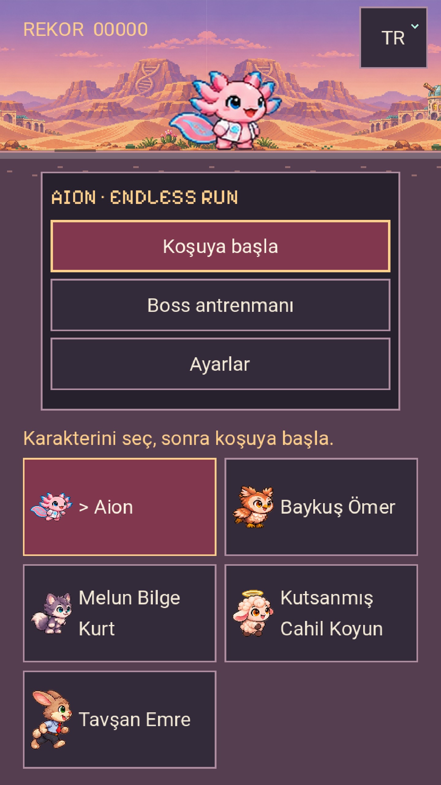

# 0.16.0 · Meyveler, manzaralar ve Emre

Gerçek neden: önceki karşılaşma üreticisi engelin türünü denetlemeden aynı noktaya, -112 yüksekliğe tek kristal koyuyordu. Yeni meyve üreticisi, engel/enemy/çukur/bitki açıklığını denetler;3–5'li diziler her kahramanın zeminden toplayabildiği yüksekliktedir. Sonradan tehlike gelince yeniden denetlenir. Skor +25, mıknatıs ve şans bonusu korunur. Rare Fragaria çileği ayrı bir ödülsüz kutlamadır.

Emre'nin resmi Drive paftası kullanıldı;144 çizilmiş poz iki orijinal PNG'de tutulur. Diğer41 PNG byte-byte değişmedi. Beşinci karakter için eski dört karakter varsayımına bağlı saldırı/takla ayrımı düzeltildi. Yeni yetenek açıkça istenmediği için güçlü bir tek sıçrama uygulandı;1.12 hız çarpanı kullanılır.6 manzara,8 ortak meyve ve11 dilin ek metinleri paket içinde ve çevrimdışıdır.

15 kaynak/sahne paketi:5531 başarılı kontrol. Bunların1833'ü meyve erişimi/tehlike açıklığı, yeniden doğrulama, bir kez puan, Emre'nin144 karede ortak ölçeği, yüz referansı, çeviriler ve gerçek sahne saldırı/boss akışını denetler.7 web paketleme ve4 Android kayıt ayrıştırma testi geçti.

Gerçek tarayıcı:31 beş kahraman animasyonu/dokunma/yön kontrolü; ayrıca8 normal girişli Emre/meyve testi. Normal, tohumu değiştirilmemiş koşuda sekiz meyve türü görüldü, Emre en az9 meyve topladı; RB ile kendi tabancasından çıkan mermiler gerçek boss canını azalttı. Testler menü, klavye/dokunma ve standart Gamepad API girdisi kullanır; dünya/öğe/düşman enjekte etmez.

Aşağıdaki görüntüler gerçek Godot renderer'ında, karşılaştırma için bilerek yerleştirilmiş meyveler ve seçilmiş biyomlarla **görsel test sahnesidir**. Normal rastgele koşu kanıtı değildir.

Tam kapsam, derleme kimliği, varsayımlar ve sınırlar [verification.json](verification.json) içindedir. Fiziksel Poco veya gerçek Xbox/PS kolu kullanıldığı iddia edilmez. Üretim ve platform sonuçları aşağıdadır.

[Normal girişlerle oynanan Emre ve meyve videosu](normal-emre-fruit.webm). Bulut yazılımsal GPU ve video kaydıyla yaklaşık53 FPS dikey /57 FPS yatay ölçüldü; fiziksel telefon performansı olarak sunulmaz.

## Yayın ve platform doğrulaması

[0.16.0 indir](https://github.com/kaansavukduran/aion_endless_run/releases/tag/v0.16.0) · [Canlı oyun](https://aionendlessrun.vercel.app/) · [Başarılı CI](https://github.com/kaansavukduran/aion_endless_run/actions/runs/43329490987)

Canlı Firefox153.0 üzerinde doğrulanmış PCK açılışı, Aion yüz referansı, gerçek dokunma saldırı/takla, koşuyu koruyan yön değişimi ve hatasız çalışma olmak üzere6 kontrol geçti. Üretim web derlemesi `86324583a4955132`, kaynak/yayın commit'i `da372255e088b54a6cad547f2846705136f194c8`. Yerel31+8 kontrol önceki aynı işlevli web derlemesinde; sonraki farklar yalnız Emre yardım cümlesi ve AZ/JA meyve sözcükleridir. Tam scopeJSON'da kayıtlıdır.

Windows Setup/portable, Linux DEB/AppImage/portable, macOS universal DMG/ZIP ve Android emülatör kapıları geçti. Android'de7 gerçek ADB menü/giriş/yön kontrolü; fiziksel Poco veya Emre'ye özel Android giriş testi değildir. [Android sonuçları](android-input-results.json). Emre'nin özel girişleri gerçek Chromium oyunu ve kaynak/sahne testinde doğrulandı.

Dokuz halka açık paket özeti ve boyutu makbuzla eşleşir. Üretim APK ve Mac ZIP ayrıca indirilip byte özetleri doğrulandı; APK'nın sabit imzası, Mac ZIP CRC ve Intel/Apple Silicon başlıkları denetlendi. [Makbuz](BUILD-RECEIPT.json) · [SHA256SUMS](SHA256SUMS). Uygulama APK kaynağı `932c3e7`; sonraki commit yalnız paket kaydı ve kanıt ekler. macOS ad-hoc imzalıdır; yerel iOS mağaza dağıtımı sahibin Apple imzasını bekler.

