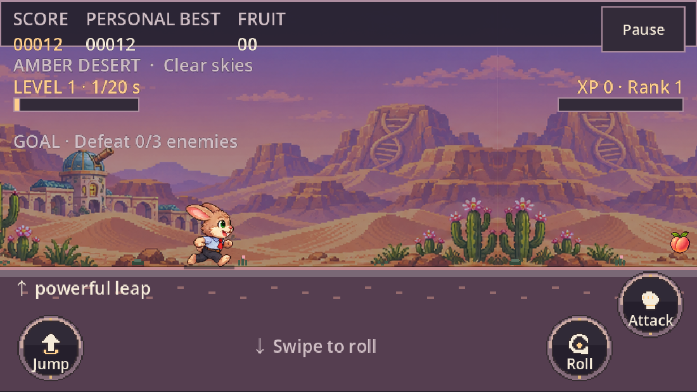
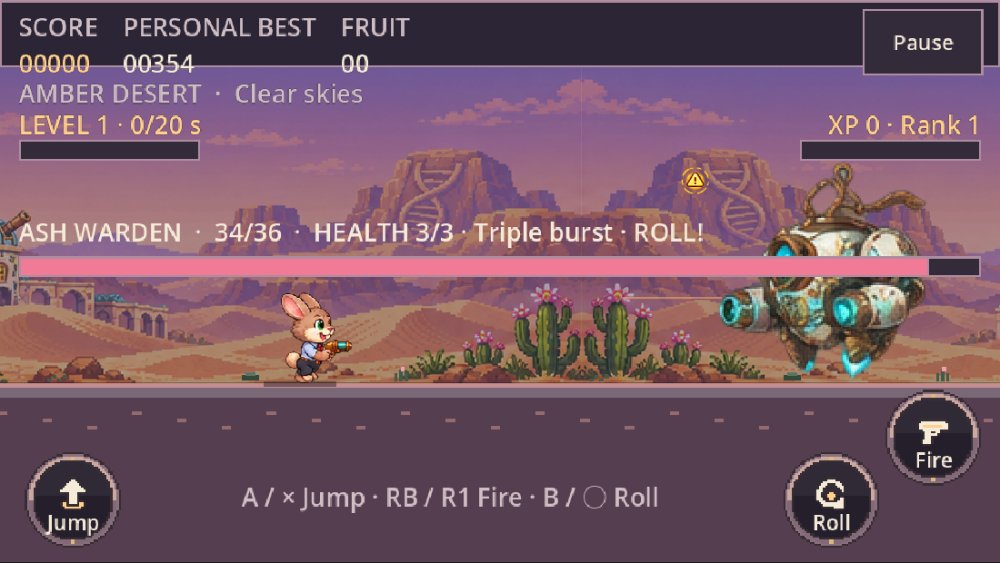
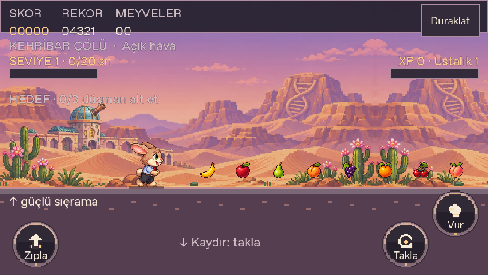
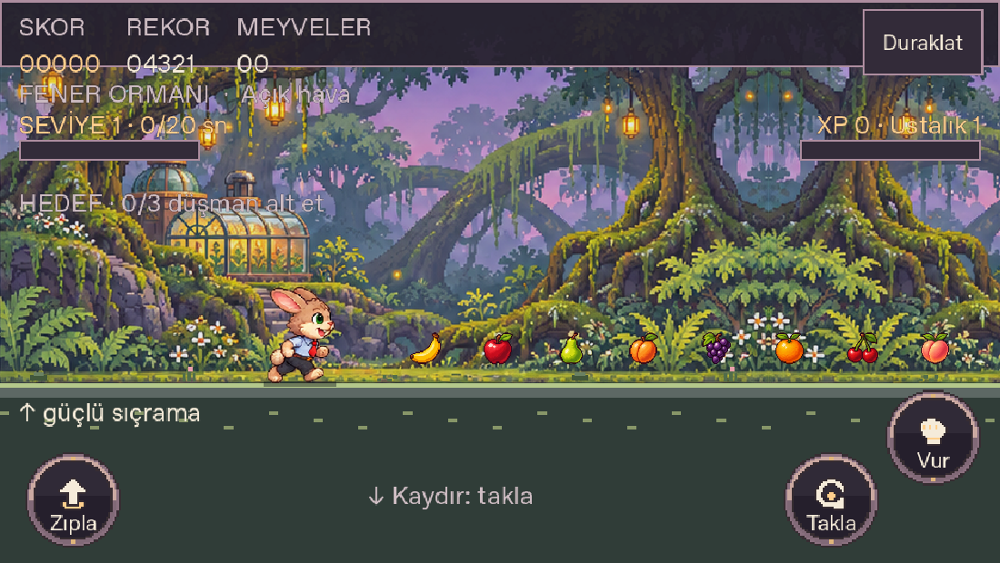
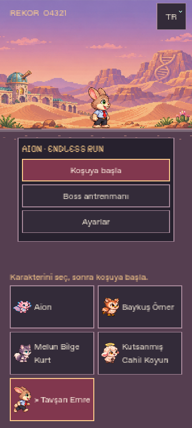

# 0.16.0 · Meyveler, manzaralar ve Emre

Gerçek neden: önceki karşılaşma üreticisi engelin türünü denetlemeden aynı noktaya, -112 yüksekliğe tek kristal koyuyordu. Yeni meyve üreticisi, engel/enemy/çukur/bitki açıklığını denetler;3–5'li diziler her kahramanın zeminden toplayabildiği yüksekliktedir. Sonradan tehlike gelince yeniden denetlenir. Skor +25, mıknatıs ve şans bonusu korunur. Rare Fragaria çileği ayrı bir ödülsüz kutlamadır.

Emre'nin resmi Drive paftası kullanıldı;144 çizilmiş poz iki orijinal PNG'de tutulur. Diğer41 PNG byte-byte değişmedi. Beşinci karakter için eski dört karakter varsayımına bağlı saldırı/takla ayrımı düzeltildi. Yeni yetenek açıkça istenmediği için güçlü bir tek sıçrama uygulandı;1.12 hız çarpanı kullanılır.6 manzara,8 ortak meyve ve11 dilin ek metinleri paket içinde ve çevrimdışıdır.

15 kaynak/sahne paketi:5531 başarılı kontrol. Bunların1833'ü meyve erişimi/tehlike açıklığı, yeniden doğrulama, bir kez puan, Emre'nin144 karede ortak ölçeği, yüz referansı, çeviriler ve gerçek sahne saldırı/boss akışını denetler.7 web paketleme ve4 Android kayıt ayrıştırma testi geçti.

Gerçek tarayıcı:31 beş kahraman animasyonu/dokunma/yön kontrolü; ayrıca8 normal girişli Emre/meyve testi. Normal, tohumu değiştirilmemiş koşuda sekiz meyve türü görüldü, Emre en az9 meyve topladı; RB ile kendi tabancasından çıkan mermiler gerçek boss canını azalttı. Testler menü, klavye/dokunma ve standart Gamepad API girdisi kullanır; dünya/öğe/düşman enjekte etmez.

Aşağıdaki görüntüler gerçek Godot renderer'ında, karşılaştırma için bilerek yerleştirilmiş meyveler ve seçilmiş biyomlarla **görsel test sahnesidir**. Normal rastgele koşu kanıtı değildir.

Tam kapsam, derleme kimliği, varsayımlar ve sınırlar [verification.json](verification.json) içindedir. Fiziksel Poco veya gerçek Xbox/PS kolu kullanıldığı iddia edilmez. Üretim yayını ve yerel platform paketlerinin sonuçları gerçekten tamamlandığında eklenir.
