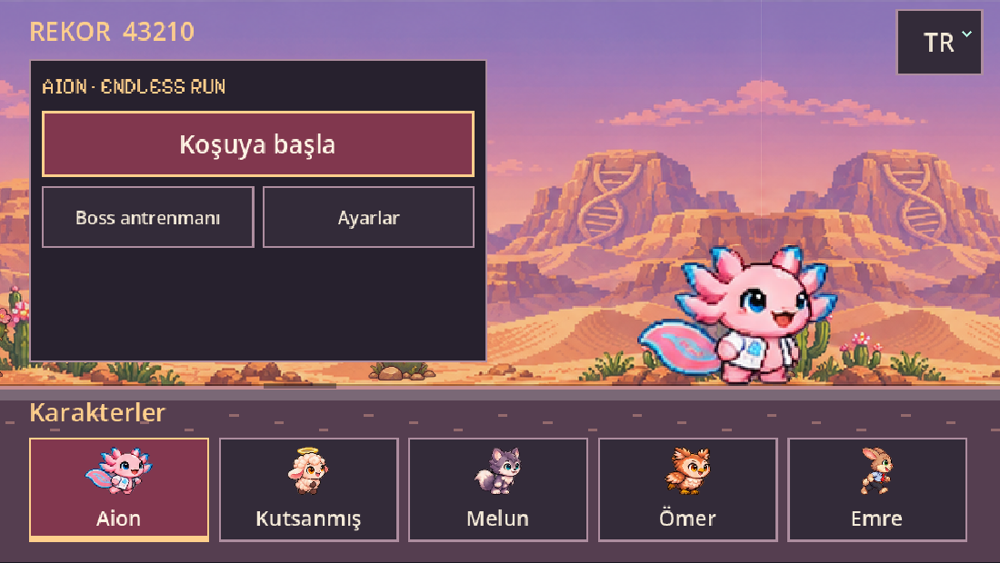
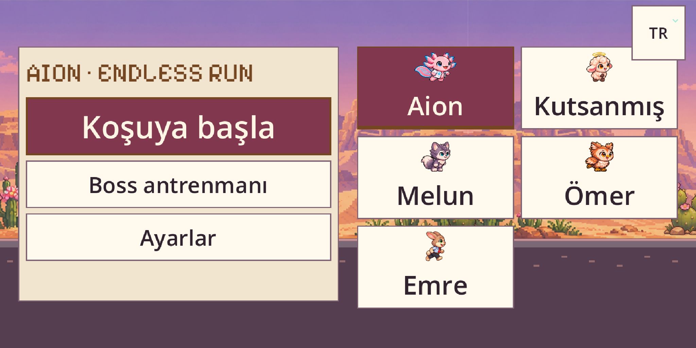
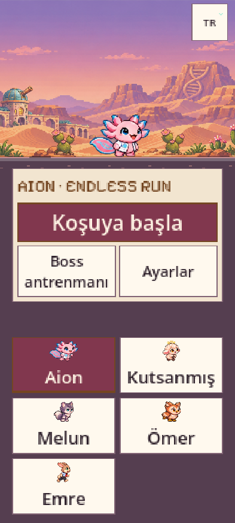
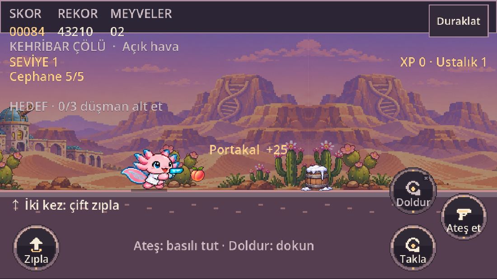
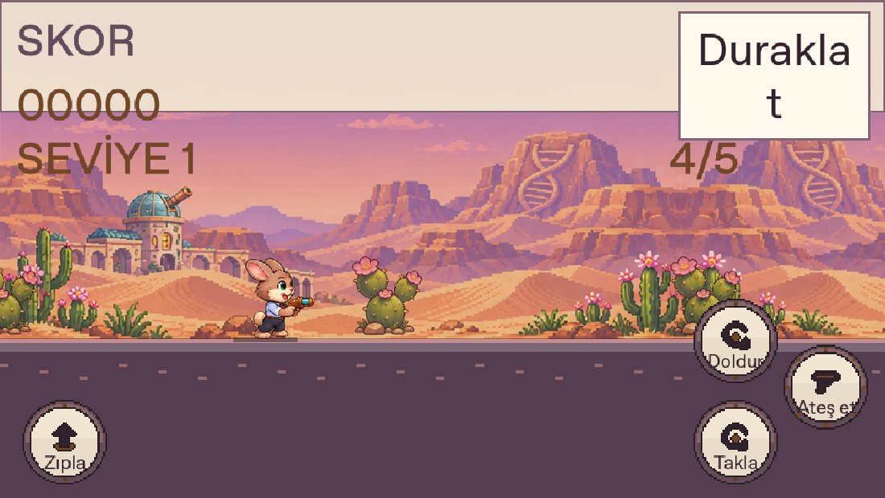
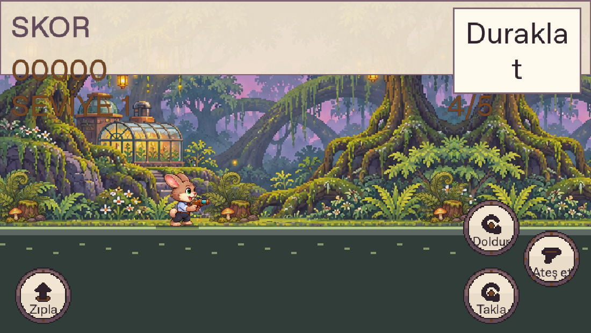
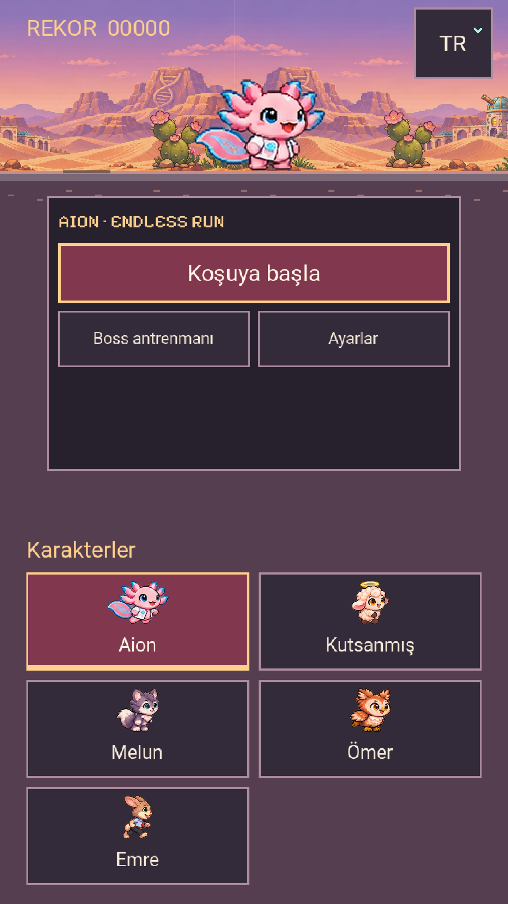
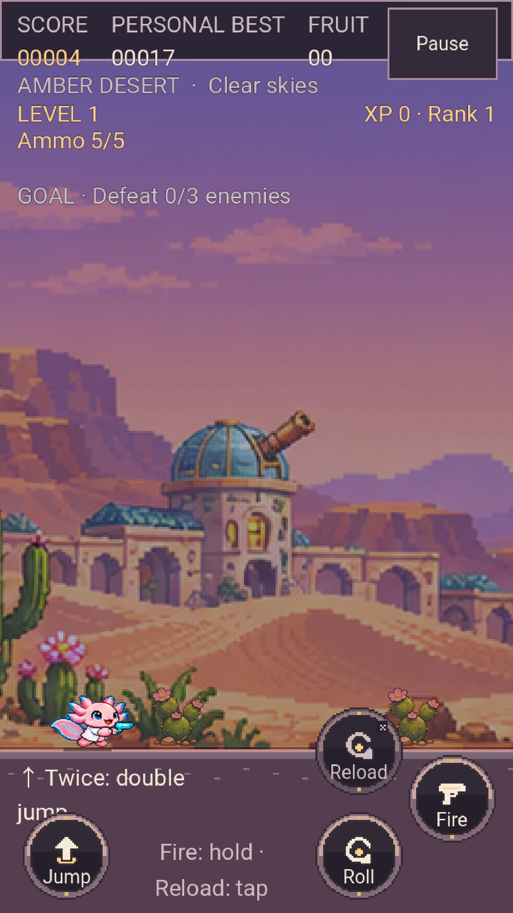

# 0.17.1 · Tabanca, şarjör ve sığan menü

5.720 kaynak/sahne kontrolü, 34 gerçek Chromium kontrolü (9 menü/dil +25 oynanış), 7 web paketleme ve4 Android kayıt ayrıştırma testi geçti. [Kapsam ve sonuçlar](verification.json).

Beş karakterin gerçek tam tabanca-koşu döngüleri ortak yüz referansını korur. Sol tıkla beş atış ve boş şarjörün durması, normal koşuda R ile bir saniyelik doldurma, RB ile gerçek boss hasarı ve X/□ ile doldurma doğrulandı. Kurt dört ayaklı deparını, baykuş süzülmesini kendi tabanca katmanıyla korur. Mobil ateş dokunmasını iptal etmek tutuşu bırakır; dikey Doldur çalışır. Duraklatıp yön değiştirmek skor/mermi/doldurma sayacını korur. Dünya/RNG enjekte edilmez; eski dil/tema/yazı/rekor için açıkça tanımlanmış kayıt tercihi fixture'ı kullanılır.

[Normal gerçek girdilerin kaydı](normal-inputs.webm) · [Dikey dokunma kaydı](portrait-inputs.webm). Bunlar yazılımsal GPU kullanan Chromium testleridir; fiziksel telefon/kol kanıtı değildir. Ateş ettikten sonra ekran görüntüsü alınana kadar atış animasyonu bitmiş olabilir; gerçek mermi ve isabetler pasif durum gözlemleriyle doğrulanır.

Eski dil tercihi sistemi bastırabiliyordu; kullanıcının cihaz kaydı görülmediği için İtalyancanın ilk nedenini kesin bilmiyoruz. Kayıt fixture'ıyla bir kez TR sistem diline dönüş, rekor/tema/%200 yazının korunması, yeni IT seçiminin kalıcılığı ve Sistem dili seçeneği test edildi. Dört boyutta beş kart/üç eylem ekranda, birbirinden ayrı ve kaydırmasızdır. Uzun ayarlar hâlâ kaydırılır.

Aşağıdaki iki görüntü gerçek Godot renderer'ında seçilmiş biyom ve bilerek yerleştirilmiş nesnelerle **görsel test sahnesidir**; normal rastgele koşu kanıtı değildir.

45 önceki asset PNG'si byte-byte aynı. Yeni bitki PNG'si üçer kareli6 tür içerir. Yeni adlar bütün11 dilde Aion, Kutsanmış, Melun, Ömer, Emre. Sistem temasını/yazı boyutunu değiştirerek taşma gizlenmedi. 15 aktif saniye seviye olur; boss/sarılma/duraklama sayılmaz. Uzun seviye/XP barları görünmez; rakamlar ve boss HP korunur.

## Yeniden doğrula

`tests/browser_firearm.py --menu-only --evidence ...` ve `--skip-menu --evidence ...` gerçek web çıktısını test eder. 0.16 ve öncesi browser sürücüleri tarihsel yakın-saldırı beklentileri taşır;0.17 silah davranışının kabul sürücüsü bu yeni dosyadır. CI on altı kaynak/sahne paketini ve gerçek yerel Android girişlerini çalıştırır. Üretim/paket sonuçları tamamlandıktan sonra aşağıya eklenir.

## Ek metin ve CI regresyonu

22 ek kontrol,11 dilde hareket/kol yardımını yeni15 saniye ve Doldur eylemiyle eşleştirir.0.17.0 adayında9 gerçek Android girişi geçti; eski `android-melee.png` adını arayan sonraki kapı başarısız oldu, indirme sürümü yayımlanmadı.0.17.1 gerçek `android-fire.png` ve `android-reload.png` görüntülerini denetler. İki flora görsel test sahnesi, aynı çizimleri kullanan0.17.0 renderer kaydından korunmuştur.

## Son derleme doğrulaması

Son0.17.1 yerel web derlemesinde (`2fccbc2982cd517b`)34 Chromium kontrolü yeniden geçti; adayla ilgili önceki not bu tekrar kaydıyla kapanmıştır. Yeni kopyalanan ekranlar ve iki video bu son gerçek girdi akışındandır. Gerçek ServiceWorker/CacheStorage ile3 çevrimdışı kontrol de geçti: normal oynayarak kazanılan kayıt, internet kapalı yeniden açılış ve tabanca atışı. [Çevrimdışı sonuçlar](offline-results.json).

Canlı adresin0.17.0 derlemesi (`49607fd4dd9c8030`) Firefox153.0 üzerinde7 kontrolü geçti: doğrulanmış PCK açılışı, Aion'un tüm koşu karelerinde sabit yüz referansı, gerçek dokunma ateş/doldur/takla, duraklatılmış koşuyu koruyan dikey dönüş ve hatasız çalışma. [Canlı Firefox kaydı](live-firefox-0170.json). Bu0.17.1 yayını diye sunulmaz: Vercel, sonraki yardım-metni yamasını ücretsiz günlük sınır nedeniyle “Deployment rate limited — retry in 24 hours” mesajıyla reddetti. Canlıdaki tüm yeni mekanikler çalışır;0.17.1'in ikincil yardım metinleri yayını bekler. Ücretli plana geçiş veya başarılı otomatik yeniden deneme yapılmadı.

İlk yayımlanmamış0.17.1 etiketinde dokümantasyon kopyalaması sırasında doğrulama manifesti eksik kaldı. Bu görevin yeni, yayımlanmamış etiketi yalnız kendi eski değeri doğrulanarak `force-with-lease` ile tamamlanmış `a41eb06` kaydına düzeltildi; önceki sürümler/etiketler korunur. Eski aday işlemleri iptal edildi. Nihai kapı [43338268399](https://github.com/kaansavukduran/aion_endless_run/actions/runs/43338268399) işlemidir.

## Yayımlanan indirmeler ve yerel platformlar

[0.17.1 indir](https://github.com/kaansavukduran/aion_endless_run/releases/tag/v0.17.1) · [Başarılı CI](https://github.com/kaansavukduran/aion_endless_run/actions/runs/43338268399) · [Dokuz paket](public-packages.json) · [Makbuz](BUILD-RECEIPT.json) · [SHA-256](SHA256SUMS).

Windows Setup/portable, Linux DEB/AppImage/portable, Mac universal DMG/ZIP ve web offline arşivi üretildi; platform başlatma/kurulum kapıları geçti. Android'de9 gerçek ADB kontrolü,6 çizilmiş ekran ve Java/GDScript başlangıç denetimi geçti. [Android sonuçları](android-input-results.json) · [CI sonuçları](ci-results.json). Emülatör native debug çıktısını test etti; yayımlanan sabit imzalı APK ayrıca indirilip özet/boyut/imza ile doğrulandı. APK kaynağı8d175d9 ile doğrulanan/yayımlanan a41eb06 arasında proje, sahneler, scripts ve assets farkı yoktur. Fiziksel Poco/iPhone/kol denenmedi.

Dokuz halka açık paket özeti/boyutu makbuzla eşleşir. Gerçek kamuya açık APK ve Mac ZIP indirildi; APK'nın önceki sürümle aynı imzası, Mac ZIP CRC ve Intel/Apple Silicon başlıkları doğrulandı. Android versionCode21. Mac ad-hoc; Apple Developer ID/noter/iOS dağıtımı sahibin imzasını bekler. Windows Authenticode yoktur.

Vercel’in günlük sınırı nedeniyle canlı oyun0.17.0, indirme/yazılı yardım düzeltmeleri0.17.1 durumundadır. Canlı oyun mekanikleri günceldir;0.17.1'in Vercel'e geçtiği iddia edilmez.
