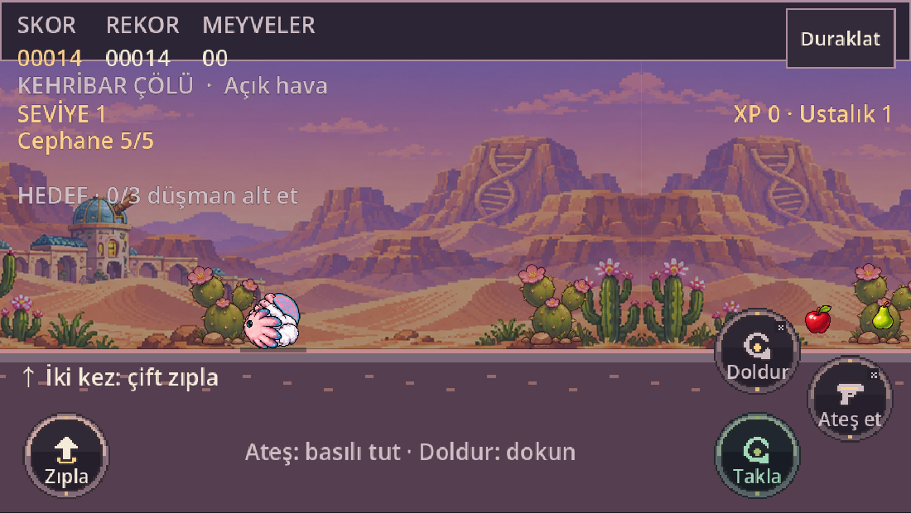
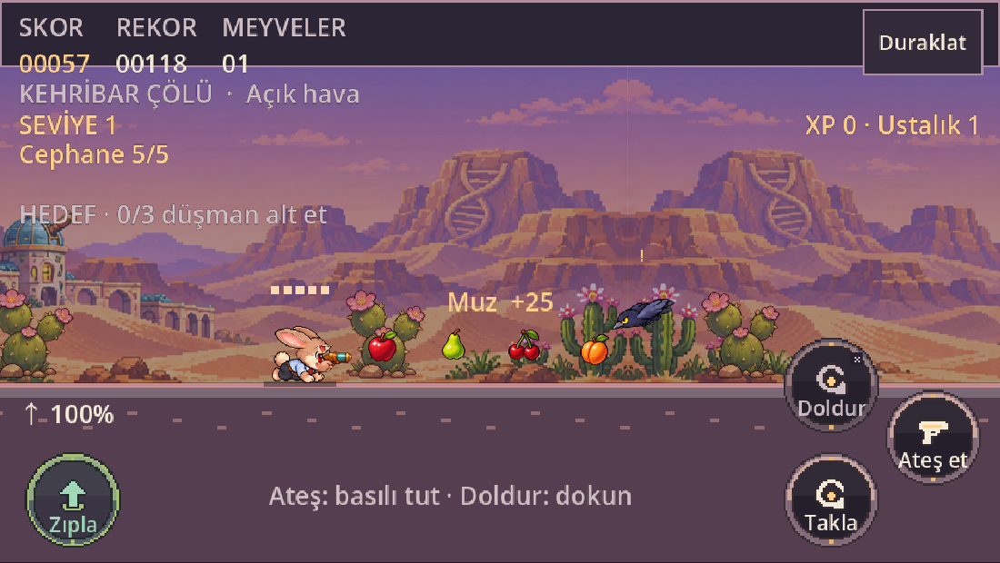
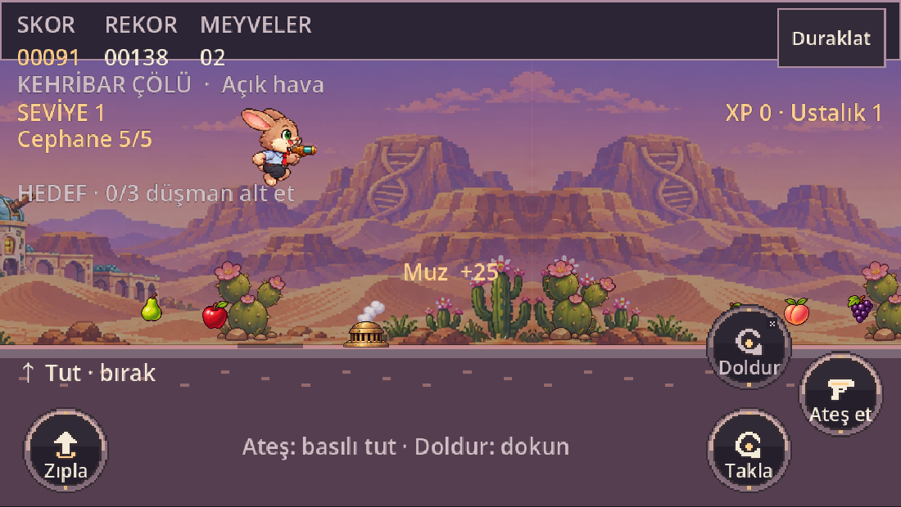
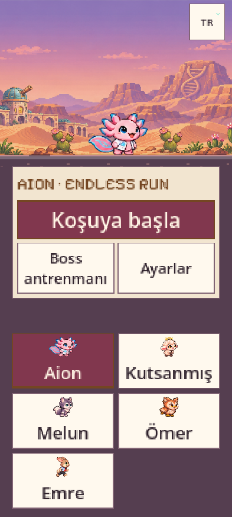
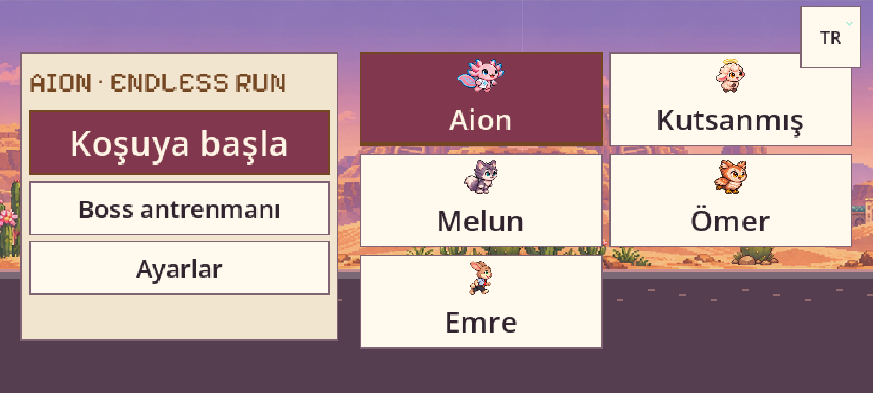
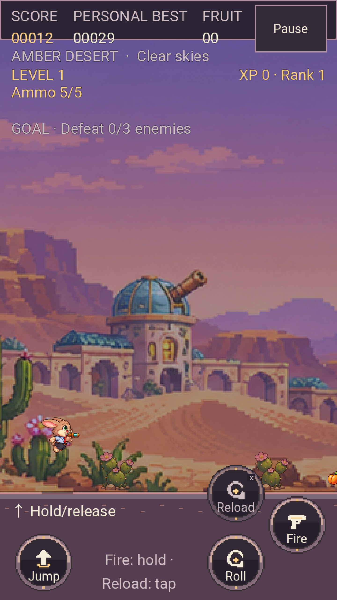
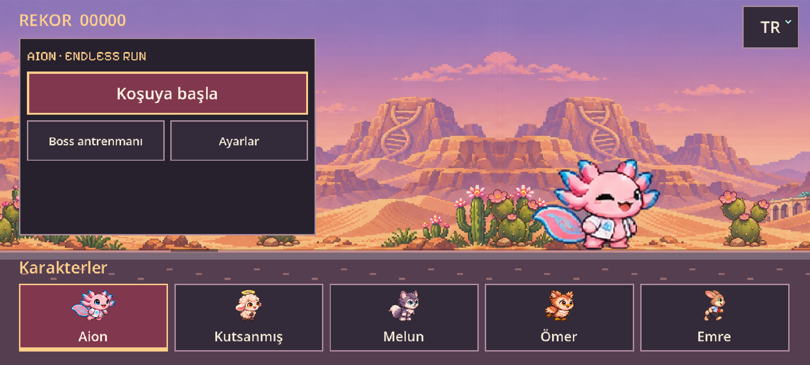
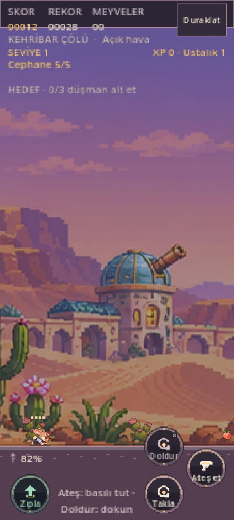

# 0.18.0 · Alçak takla, şarjlı Emre, kaydırmasız menüler

17 kaynak/sahne grubunda **8.492 kontrol**, gerçek Chromium girişlerinde **89 kontrol**, alt dizin üzerinde gerçek çevrimdışı yüklemede **3 kontrol**, web paketleme **7** ve Android kayıt ayrıştırma **4** testi geçti. [Makinece okunur sonuçlar](verification.json).

Beş kahramana toplam60 çizilmiş poz eklendi: diz bükme, yere yaklaşma, saat yönünde öne dönme, doğrulma. Basılı takla yalnız alçak dönüş pozlarında kalır. Sabit gövde/zemin referansı ve her karakter için tek ölçek kullanılır. Önceki46 PNG dosyasının byte düzeyinde aynı olduğu ayrıca doğrulandı. Eski paftalar silinmedi veya yeniden çizilmedi. Koyun takipçileri kendi gecikmeli yol kayıtlarını kullanır.

Emre klavye, standart Gamepad API ve gerçek tarayıcı dokunmasıyla yerde şarj edildi, bırakılınca tam bir sıçrama yaptı. Kısa/orta/tam tutuşun gerçek tepe yükseklikleri artıyor. İptal edilen dokunma ve yön değişimi yanlış sıçrama üretmiyor. Gerçek CDP touchCancel ile, Godot'un iptali normal bırakma olarak ilettiği görüldü; DOM touchcancel yakalama fazında sahiplik temizlenerek düzeltildi. Chrome'un geçerli uzun dokunmada ürettiği uyumluluk pointercancel olayına ayrıca abone olunmuyor. [Girdi kaydı](charge-roll-inputs.webm) · [55 kontrol ve ölçülen yükseklikler](browser-charge-roll.json).

Menü sürücüsündeki ilk deneme, Godot'un düğüm adlarında noktayı alt çizgiye çevirmesi nedeniyle gerçek 200% seçeneğini yanlış adla arıyordu; doğru düğüm adıyla yeniden çalıştırıldı ve bütün sayfalar geçti. Bu bir uygulama arızası olarak raporlanmadı. Döndürmeden sonra testin fiziksel CDP parmağı da kaldırıldı; motorun sahipliği bırakması ile fiziksel girişin sonlandırılması ayrı doğrulandı.

Ana menü dört ekran ölçüsünde ve200% yazıda tek bakışta sığar. Uzun ayarlar açıkça sayfalıdır; bütün font/kol seçeneklerine gerçek Önceki/Sonraki dokunmalarıyla ulaşıldı. Sonuç işlemleri sayfalarda görünür kalır. Gizli autowrap Label ölçümü gerçek şekillendirme sonrası alınır; yazı/tema tercihi küçültülerek taşma saklanmaz. [9 menü/dil kontrolü](browser-menu.json).

[25 tabanca regresyonu](browser-firearm.json): beş karakterin tam tabancalı koşu döngüsü,5 mermi, boş şarjör,1 aktif saniyelik elle doldurma, gerçek boss hasarı, RB/X, baykuş süzülmesi, dört ayaklı kurt, dokunma iptali ve yön değişimi. Bu grup ve55'lik grup son `b22e878bec53d134` uygulama çıktısında yeniden geçti. Dünya, düşman, fizik veya RNG enjekte edilmedi.9'luk menü grubunda açıkça belgelenen eski İtalyanca/tema/rekor kayıt fixture'ı kullanılır.

## Çevrimdışı ve platform sınırı

`/aion_endless_run/` alt dizininden gerçek ServiceWorker/CacheStorage kurulumu, normal oyunla kazanılmış rekorun çevrimdışı yeniden açılışta korunması ve internet kapalıyken tabanca atışı doğrulandı. Bu yerel alt dizin deneyi Pages üretim yayınının test edildiği anlamına gelmez. [Sonuç](offline-results.json).

Yerel tarayıcı denemeleri yazılımsal GPU ile Chromium'dur; fiziksel Poco/iPhone/kol testi değildir. Android dağıtım APK'sı aynı kalıcı imza veversionCode22 ile oluşturuldu, bytes/SHA/imza doğrulandı. CI'da gerçek Android emülatör girdileri, Windows/Linux/macOS paket kurulum/çalıştırmaları ve üretim Pages adresi tamamlandığında sonuçlar aşağıya eklenir. Vercel0.18.0 ilk adayı yayımladı (`c75d65b445ea55a7`, c9ab407); sonraki geniş sistem fontu düzeltmesi yeniden günlük kotaya takıldı. Kullanıcı ikinci adresi ve GitHub Actions kaynağını açıkça onayladı. İki origin'in kayıtları ayrıdır.

## Uzak ortamda bulunan geniş font regresyonu

İlk GitHub CI koşusu43349358325, yereldeki varsayılan fonttan daha geniş DejaVu Sans ile200%/960×540 düzeninde son karakter kartını ve üç dil seçeneğini ekran dışında buldu. Yerelde aynı gerçek fontla yeniden üretildi. Büyütülmüş yatay menüde karakterlere60%, ana eylemlere40% alan verildi; kart yüksekliği Label şekillendirmesinden ölçülüyor. Sistem dili, diğer11 dil ile aynı ızgarada: fazladan yüksek satır yok. DejaVu Sans ve Liberation Sans, TR/EN ve iki yön için348 ek kontrol eklendi. Son kaynak paketi8.492 kontrol geçti. Son menü tarayıcı deneyi ve gerçek alt-dizin çevrimdışı deneyi yeni `b22e878bec53d134` web çıktısında tekrar geçti.55 davranış ve25 tabanca kontrolü de son adayda tekrar geçti; üretim davranışı ayrıca doğrulanır.

## Platform kapıları tamamlandı

[main CI43350354438](https://github.com/kaansavukduran/aion_endless_run/actions/runs/43350354438):17 kaynak paketi, Windows installer/portable gerçek çalıştırma, Linux portable/DEB/AppImage gerçek çalıştırma ve macOS uygulama/DMG kapıları geçti. Uzak kaynak kontrolü8.579; yerelde8.492. Fark, sistem fontuna göre gerçekten görünür sayfalardaki denetlenen kontrol sayısından gelir; iki ortamda da sıfır hata. [CI özeti](ci-results.json).

Android API30 emülatöründe internet kapalıyken11 gerçek ADB giriş kontrolü geçti. Dokunarak şarj/bırakma, takla, süzülme, ateş ve gerçek5 mermi doldurma; duraklatıp yön değiştirme dahildir. Sekiz gerçek renderer ekranı boş olmadığı için ayrı denetlendi. CI APK'sı geçici test imzalıdır; indirilecek APK ayrıca sabit imzayla yerelde üretildi ve hash/imza eşlemesiyle sahnelendi. [Android sonuçları](android-input-results.json).

Pages dağıtımı43351182798 başarılı, sürüm0.18.0 ve içerik kimliği2dc5e96fab077b9f gerçek HTTPS manifestinden okundu. Canlı tarayıcı doğrulaması aşağıda tamamlandı.

## Gerçek yayın ve indirmeler

[GitHub Pages'te oyna](https://kaansavukduran.github.io/aion_endless_run/) · [0.18.0 indir](https://github.com/kaansavukduran/aion_endless_run/releases/tag/v0.18.0).

Gerçek Pages adresinde Firefox153 ve Chromium151 ile9'ar kontrol geçti: SHA doğrulanan PCK ile açılış, Aion'un tam7 koşu karesinde sabit yatay referans, dokunarak ateş/doldur/takla, duraklamada dikey dönüşün korunması, Emre'nin yerde şarjı ve bırakınca tek sıçrama. Hata/diyalog yok. [Firefox](live-firefox.json) · [Chromium](live-chromium.json). Bunlar fiziksel Poco/iPhone testleri değildir.

Bulut tarayıcısının sertifika deposu yürütücünün proxy CA'sını tanımadığı için üretim HTTPS yanıtları sistem CA deposuyla doğrulanarak tarayıcıya iletildi; TLS doğrulaması kapatılmadı. İlk Chromium denemesinde91MB PCK'nin base64 CDP yanıtı100MiB DevTools boru sınırını aştı; log açıkça `not enough capacity` gösterdi. Bu tanı aracı sınırını16MiB aralıklı iletimle çözdük. Birleştirilen gerçek üretim baytları oyunun mevcut SHA-256 doğrulamasından geçti. Oyun/manifest değiştirilmedi. Firefox tam yanıtı kullandı. Bu canlı tanıdaki ServiceWorker kapalıdır; gerçek alt dizin çevrimdışı testi ayrı kaydedildi.

[Etiket CI43351637933](https://github.com/kaansavukduran/aion_endless_run/actions/runs/43351637933) tüm platform kapılarını tekrar geçti ve9 paketi birlikte yayımladı. [Kamuya açık paket doğrulaması](public-packages.json), [kaynak/derleme makbuzu](BUILD-RECEIPT.json), [SHA-256 listesi](SHA256SUMS).9 dosyanın GitHub içerik özetleri makbuzla eşleşiyor. Gerçek indirilen Android APK bytes/SHA ve v2/v3 imzası beklenen kalıcı imzayla aynı; versionCode22/0.18.0/uygulama kimliği doğrulandı. Gerçek indirilen Mac ZIP CRC hatasız, Mach-O Intel x86_64 ve Apple Silicon arm64 içeriyor. Native iOS, Apple Developer ID/noter ve Windows Authenticode sınırlamaları değişmedi.

Kayıt zamanı `verification.json` içinde Europe/Istanbul saat dilimindedir. Pages ve Vercel farklı origin'lerdir; eski Vercel kayıtları yerinde kalır, yeni adresteki rekorlar ayrıdır. Bu bir otomatik kayıt taşıma veya Drive senkronizasyonu değildir.
